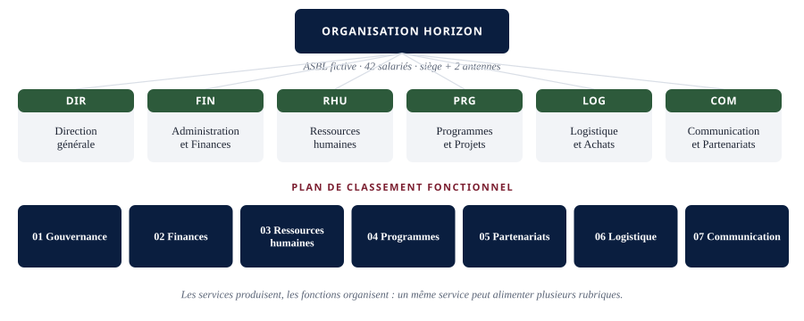

# Parcours de lecture

Tous les lecteurs commencent par les chapitres 1 à 6. Ensuite, chacun peut suivre un parcours adapté à son métier. Les chapitres signalés en **gras** sont prioritaires pour votre profil.

| Profil | Parcours conseillé | Points d'attention |
|---|---|---|
| **Débutant, étudiant** | 1 → 6, puis 7, 8, 9, **10**, annexes | Faites tous les QCM ; constituez votre propre glossaire |
| **Assistant administratif, secrétaire** | 1 → 6 (**2, 3, 4**), puis 7, annexes C et D | Registre d'arrivée, circuit du courrier, nommage des fichiers |
| **Comptable, responsable administratif et financier** | 1 → 6 (**2, 6**), puis **8**, 7, 10 | Circuit des factures, durées de conservation, piste d'audit |
| **Responsable des ressources humaines** | 1 → 6 (**3, 6**), puis **8**, 9 | Dossiers du personnel, confidentialité, protection des données |
| **Archiviste débutant** | 1 → 10 dans l'ordre, toutes les annexes | Description, évaluation, conservation préventive, diagnostic |
| **Dirigeant d'entreprise, responsable d'ASBL** | 1, 2, 6, puis **8**, **10** | Politique d'archivage, responsabilités, risques, indicateurs |
| **Agent d'administration** | 1 → 6 (**6**), puis 8, 10 | Règles propres aux archives publiques de votre pays |
| **Consultant, professionnel de la GED** | 1 → 6 en révision, puis **7**, **9**, **10** | Diagnostic, GED et archivage électronique, IA |

: Les parcours par profil

## Le fil rouge en un coup d'œil

{width=96%}
