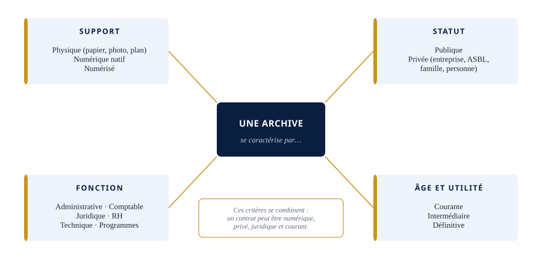

::: situation
Mardi, 9 h 40. La directrice exécutive d'une association reçoit un courriel de son principal bailleur : un audit de clôture aura lieu dans trois semaines sur une subvention versée quatre ans plus tôt. Il faut produire les contrats, les factures, les preuves de paiement et les rapports d'activité. L'équipe fouille les armoires, interroge d'anciens collègues, cherche dans les messageries. Au bout de dix jours, il manque encore un tiers des justificatifs.

Ce scénario n'a rien d'exceptionnel. Il ne révèle pas un manque de bonne volonté, mais l'absence d'une discipline : l'archivistique. C'est elle que ce chapitre vous propose de découvrir.
:::

::: objectifs
- Définir l'archivistique et la distinguer des disciplines voisines.
- Expliquer ce qu'est une archive et reconnaître ses différentes formes.
- Décrire le rôle, les responsabilités et les compétences de l'archiviste.
- Mesurer les conséquences concrètes d'une mauvaise gestion documentaire.
:::

## Qu'est-ce que l'archivistique ?

Le mot évoque souvent des caves poussiéreuses et des registres jaunis. Cette image est trompeuse. L'**archivistique** est la discipline qui étudie et met en œuvre les principes et les méthodes permettant de **constituer, organiser, conserver, rendre accessibles et valoriser les archives**, quel que soit leur support. Elle répond à trois questions simples en apparence : quels documents garder, comment les garder, et pour qui.

Une organisation produit chaque jour des traces de son activité : un contrat signé, une facture payée, un procès-verbal de réunion, un courriel qui valide une dépense. Prises une à une, ces pièces semblent banales. Réunies et organisées, elles deviennent la **mémoire probante** de l'organisation : elles prouvent ce qui a été décidé, payé, promis ou réalisé.

### Une discipline ancienne, des pratiques renouvelées

L'archivistique s'est construite par étapes. Quelques repères suffisent pour comprendre d'où viennent les méthodes actuelles.

| Période | Apport majeur | Ce qu'il change en pratique |
|---|---|---|
| 1841, France | Formulation du **principe de respect des fonds** (circulaire du 24 avril 1841) | On ne mélange pas les documents de producteurs différents. |
| 1898, Pays-Bas | Manuel de Muller, Feith et Fruin | Premières règles écrites de classement et de description. |
| 1922, Royaume-Uni | Manuel de Hilary Jenkinson | L'archiviste est garant de l'intégrité et de la chaîne de garde des documents. |
| 1956, États-Unis | *Modern Archives* de T. R. Schellenberg | Les archives modernes, produites en masse, doivent être **évaluées** et triées. |
| 1961, France | Théorie des **trois âges** (Yves Pérotin) | Le document change de statut selon son utilité : courant, intermédiaire, définitif. |
| Années 1990 | *Records continuum* (Australie), archivistique intégrée (Québec) | Le document est géré de façon continue, de sa création à son sort final. |
| 2016-2020 | ISO 15489-1:2016, ISO 30300:2020, ISO 16175-1:2020 | Vocabulaire et principes communs pour les documents papier et numériques. |

: Repères historiques de l'archivistique

Retenez surtout la dernière ligne : aujourd'hui, l'archivistique ne commence pas quand le document devient « vieux ». Elle commence **dès sa création**. C'est l'idée centrale du *records management*, que l'on traduit par **gestion des documents d'activité** : organiser les documents pendant qu'ils servent encore, pour qu'ils restent fiables, retrouvables et exploitables jusqu'à leur sort final.

::: definition
**Document d'activité** (*record*). Selon la norme ISO 15489-1:2016, il s'agit d'une information créée, reçue et conservée à titre de preuve et en tant qu'actif par un organisme ou une personne, dans le cadre de ses obligations légales ou de la conduite de ses activités.

**Gestion des documents d'activité** (*records management*). Domaine de gestion chargé du contrôle efficace et systématique de la création, de la réception, de la conservation, de l'utilisation et du sort final des documents d'activité.
:::

## Archivistique, archivage, documentation, bibliothéconomie : ne pas confondre

Ces quatre termes sont souvent employés l'un pour l'autre. Leur distinction n'est pas une coquetterie de spécialiste : elle détermine les méthodes à appliquer.

| Notion | Objet | Question posée | Exemple |
|---|---|---|---|
| **Archivistique** | La discipline dans son ensemble | Quels principes appliquer aux archives ? | Définir les règles de classement d'une ASBL. |
| **Archivage** | L'opération concrète de conservation | Comment conserver ce document en sécurité et le retrouver ? | Ranger les factures de 2024 dans des boîtes cotées. |
| **Documentation** | L'information collectée pour être consultée | Quelle information utile mettre à disposition ? | Une veille sur les règles fiscales, un dossier de presse. |
| **Bibliothéconomie** | Les publications (livres, revues) | Comment acquérir, cataloguer et prêter des ouvrages ? | Le catalogue de la bibliothèque d'un centre de formation. |

: Quatre notions voisines

La différence décisive tient à l'**origine** du document. Un livre est acheté, il existe en de nombreux exemplaires et peut être remplacé. Une archive est **produite ou reçue** par l'organisation dans le cours de son activité, elle est souvent **unique** et elle a une **valeur de preuve**. Perdre le livre est ennuyeux ; perdre le contrat original peut être ruineux.

::: exemple
Un rapport annuel d'une fondation, imprimé à 500 exemplaires et rangé au centre de documentation, relève de la **documentation**. Le même rapport, dans sa version validée par le conseil d'administration, accompagné du procès-verbal d'approbation et des épreuves annotées, relève des **archives** de la fondation.
:::

## Qu'est-ce qu'une archive ?

Une archive n'est pas définie par son âge. Une facture reçue ce matin est déjà une archive au sens professionnel du terme. En France, par exemple, l'article L211-1 du Code du patrimoine définit les archives comme l'ensemble des documents, y compris les données, quels que soient leur date, leur lieu de conservation, leur forme et leur support, produits ou reçus par toute personne ou organisme dans l'exercice de son activité. D'autres pays retiennent des définitions proches, mais c'est la loi de votre juridiction qui fait foi.

Trois critères permettent de reconnaître une archive :

1. **Elle est produite ou reçue dans l'exercice d'une activité.** Un courriel personnel n'en est pas une ; le courriel qui accepte un devis en est une.
2. **Elle est liée à son contexte.** Une facture isolée a peu de valeur si l'on ne sait plus à quel achat, à quel projet ou à quel paiement elle se rattache.
3. **Elle peut servir de preuve ou d'information.** Elle documente une décision, un droit, une obligation, une opération.

On appelle **fonds d'archives** l'ensemble des documents produits ou reçus par une même personne ou un même organisme. Le **producteur** est cette personne ou cet organisme. Ces deux notions fondent le principe de respect des fonds que nous retrouverons dans tout l'ouvrage.

## Les différents types d'archives

Les archives se classent selon plusieurs critères qui se combinent. Un même document peut être, à la fois, numérique, privé, comptable et confidentiel.

{width=92%}

### Selon le support : physiques et numériques

Les **archives physiques** (ou analogiques) reposent sur un support matériel : papier, photographie argentique, microfilm, plan. Les **archives numériques** sont des informations encodées dans des fichiers. On distingue :

- les documents **nativement numériques**, créés directement sous forme électronique (tableur, courriel, facture électronique) ;
- les documents **numérisés**, qui sont la copie numérique d'un original physique.

Cette distinction compte : un document numérisé n'a pas automatiquement la même valeur juridique que son original. Nous y reviendrons au chapitre 7.

### Selon le statut : publiques et privées

Les **archives publiques** proviennent de l'activité de l'État, des collectivités, des établissements et des organismes chargés d'une mission de service public. Elles sont généralement soumises à une loi sur les archives qui encadre leur conservation, leur élimination et leur communication. Les **archives privées** proviennent des entreprises, des associations, des familles, des personnes. Elles restent soumises aux règles commerciales, fiscales, sociales et de protection des données.

::: attention
Une ASBL ou une entreprise privée qui gère un service public, ou qui reçoit des fonds publics, peut produire des documents soumis à des règles particulières. Ne présumez jamais du statut : vérifiez la législation de votre pays.
:::

### Selon la fonction ou le domaine

On parle d'archives **administratives**, **comptables et financières**, **juridiques**, **sociales et de ressources humaines**, **techniques**, **scientifiques** ou **audiovisuelles**. Cette typologie est utile pour construire un plan de classement (chapitre 3) et pour fixer des durées de conservation (chapitre 6).

### Selon l'âge et l'utilité

C'est la théorie des **trois âges** : archives courantes, intermédiaires et définitives. Elle fera l'objet du chapitre 2.

## L'archiviste : rôle et responsabilités

L'archiviste n'est pas un simple « rangeur ». Il est le garant d'un système qui permet à l'organisation de **prouver, décider et se souvenir**. Selon la taille de la structure, la fonction peut être assurée par un professionnel dédié, un records manager, un responsable de la gestion documentaire ou, dans une petite ASBL, par un assistant administratif formé.

{width=95%}

Ses responsabilités se déclinent ainsi :

- **Conseiller** les services sur la création et l'organisation de leurs documents.
- **Collecter** les documents qui n'ont plus d'usage quotidien et organiser leur transfert.
- **Classer et décrire** les fonds pour les rendre retrouvables.
- **Conserver** les documents dans des conditions qui garantissent leur intégrité.
- **Communiquer** les documents aux personnes autorisées, en respectant la confidentialité.
- **Évaluer** les documents pour décider de leur sort final, en lien avec la direction et le juriste.

### Les compétences attendues

| Compétences techniques | Compétences comportementales |
|---|---|
| Maîtrise des principes archivistiques (respect des fonds, trois âges) | Rigueur et sens de la méthode |
| Construction d'un plan de classement et d'un tableau de gestion | Discrétion et loyauté face aux informations sensibles |
| Description et indexation | Pédagogie pour convaincre les services |
| Conservation préventive | Diplomatie : on demande aux collègues de changer leurs habitudes |
| Notions juridiques (preuve, prescription, protection des données) | Capacité d'analyse et de synthèse |
| Outils numériques : GED, tableur, formats, métadonnées | Curiosité pour l'histoire et le fonctionnement de l'organisation |

: Compétences de l'archiviste

Les codes de déontologie de la profession, notamment celui adopté par le Conseil international des archives (ICA) en 1996, insistent sur l'intégrité des documents, l'impartialité, l'accès équitable et le respect de la vie privée.

## Pourquoi l'archivistique compte dans les entreprises et les ASBL

Une bonne gestion des archives n'est pas un luxe réservé aux grandes administrations. Pour une entreprise ou une association, elle produit des bénéfices très concrets.

- **Prouver** : en cas de litige, de contrôle fiscal ou d'audit, seul le document retrouvé, complet et authentique compte.
- **Rendre compte** : les bailleurs, les membres, les autorités exigent des justificatifs. La redevabilité repose sur des archives fiables.
- **Gagner du temps** : un document retrouvé en deux minutes plutôt qu'en deux heures, c'est du temps rendu aux missions.
- **Protéger** : les données personnelles des salariés et des bénéficiaires doivent être sécurisées.
- **Décider** : on ne pilote pas un projet sans les données des projets précédents.
- **Transmettre** : quand un collaborateur part, son savoir doit rester dans les dossiers, pas seulement dans sa mémoire.

## Les conséquences d'une mauvaise gestion documentaire

À l'inverse, l'absence d'organisation coûte cher, même si ce coût reste souvent invisible jusqu'à la crise.

| Dysfonctionnement | Conséquence directe | Risque pour l'organisation |
|---|---|---|
| Documents introuvables | Temps perdu, doublons | Perte de productivité |
| Justificatifs manquants | Dépenses jugées inéligibles | Remboursement exigé par un bailleur, redressement |
| Originaux perdus | Impossible de prouver un droit | Perte d'un litige |
| Documents détruits trop tôt | Absence de preuve | Sanction, contentieux |
| Documents conservés trop longtemps | Encombrement, coûts de stockage | Exposition inutile de données personnelles |
| Accès non contrôlé | Fuite d'information | Atteinte à la réputation, sanction |
| Versions multiples d'un même document | Confusion | Décision prise sur une base erronée |

: Ce que coûte le désordre

::: horizon
**Présentation de l'Organisation Horizon** *(cas fictif à visée pédagogique)*

Tout au long de ce livre, nous suivrons l'**Organisation Horizon**, une ASBL fictive de taille moyenne qui œuvre dans l'éducation et l'insertion professionnelle des jeunes. Elle emploie 42 salariés, gère une dizaine de projets financés par quatre bailleurs et dispose d'un siège et de deux antennes.

Elle comprend six services : **Direction générale (DIR)**, **Administration et Finances (FIN)**, **Ressources humaines (RHU)**, **Programmes et Projets (PRG)**, **Logistique et Achats (LOG)**, **Communication et Partenariats (COM)**.

Les personnes que nous croiserons :

- **Mireille**, directrice exécutive ;
- **Jonas**, responsable administratif et financier ;
- **Esther**, assistante administrative, qui deviendra la référente archives ;
- **Patrick**, comptable ;
- **Grâce**, chargée des ressources humaines ;
- **Samuel**, coordinateur des programmes.

Le diagnostic de départ est sévère : aucun plan de classement ; factures dispersées entre la comptabilité, les projets et les antennes ; contrats conservés dans des tiroirs personnels ; dossiers du personnel incomplets ; cartons d'archives entreposés dans un ancien magasin humide ; fichiers numériques éparpillés sur une quinzaine d'ordinateurs ; aucun registre de consultation ; aucune politique d'archivage ; un risque réel de perte et de divulgation d'informations.

Chapitre après chapitre, nous transformerons ce désordre en un système d'archivage fonctionnel.
:::

## Cas pratique : les justificatifs introuvables

::: cas
**Contexte.** L'Organisation Horizon a reçu, il y a quatre ans, une subvention de la *Fondation Alizé* (bailleur fictif) pour un projet de formation de 200 jeunes. Le bailleur annonce un audit de clôture. Il demande : la convention de financement signée, les factures et preuves de paiement, les listes de présence des formations, les rapports narratifs et financiers.

Constat après dix jours de recherche :

- la convention signée est introuvable ; seul un brouillon existe dans la messagerie de l'ancien coordinateur ;
- 60 % des factures sont retrouvées, mélangées à celles d'autres projets ;
- les listes de présence d'une antenne ont été stockées dans un carton touché par une infiltration d'eau ;
- le rapport financier final existe en trois versions différentes.

**Questions.**

1. Identifiez les archives concernées et classez-les par type (fonction et support).
2. Pour chaque document manquant, quel risque l'association court-elle ?
3. Quelles causes profondes expliquent la situation ?
4. Proposez trois mesures immédiates pour limiter les dégâts et trois mesures durables.
:::

::: corrige
**Éléments de réponse.**

1. *Convention* : archive juridique et financière, originale papier signée (et éventuellement copie numérique). *Factures et preuves de paiement* : archives comptables, papier et numériques. *Listes de présence* : archives de programme, papier. *Rapports* : archives de programme et financières, numériques.
2. Convention absente : impossibilité de prouver les conditions d'éligibilité des dépenses. Factures manquantes : dépenses déclarées inéligibles et remboursement exigé. Listes endommagées : impossibilité de prouver la réalisation des activités. Versions multiples : doute sur la sincérité des comptes rendus.
3. Absence de plan de classement par projet, absence de règle sur la conservation des originaux, dépendance aux messageries individuelles, local inadapté, absence de procédure de validation et de versionnage.
4. *Immédiat* : demander une copie certifiée de la convention au bailleur ; reconstituer les preuves de paiement à partir des relevés bancaires ; sécuriser et faire sécher les listes endommagées et en établir une copie. *Durable* : créer un dossier unique par projet et par bailleur ; désigner un responsable des archives ; adopter un plan de classement et une règle de nommage des versions.
:::

## Erreurs fréquentes à éviter

::: attention
- **Croire qu'une archive est un vieux document.** Le travail archivistique commence dès la création du document.
- **Confondre archives et documentation.** Une revue achetée ne se gère pas comme un contrat signé.
- **Considérer que tout se garde « au cas où ».** Conserver sans règle encombre, coûte et expose les données personnelles.
- **Confier les archives à « celui qui a du temps ».** La fonction exige une désignation formelle, une formation et une autorité.
- **Laisser chaque collaborateur gérer ses documents à sa façon.** Sans règles communes, l'organisation perd sa mémoire à chaque départ.
:::

## À retenir

::: retenir
- L'**archivistique** organise, conserve et rend accessibles les documents produits ou reçus par une organisation dans le cadre de son activité.
- Une **archive** se définit par son origine (activité), son contexte et sa valeur de preuve, non par son âge.
- Les archives se caractérisent par leur **support**, leur **statut**, leur **fonction** et leur **âge**.
- L'**archiviste** conseille, collecte, classe, conserve, communique et évalue.
- Le coût d'une mauvaise gestion est souvent invisible jusqu'au jour d'un audit, d'un litige ou d'un départ.
:::

## QCM

::: qcm
**1.** Une facture reçue ce matin est-elle une archive ?\
a) Non, il faut attendre la clôture de l'exercice.\
b) Oui, car elle est reçue dans le cadre de l'activité et peut servir de preuve.\
c) Seulement si elle est rangée dans un local d'archives.

**2.** Le principe de respect des fonds consiste à :\
a) conserver tous les documents sans exception ;\
b) ne pas mélanger les documents de producteurs différents ;\
c) classer les documents par ordre alphabétique.

**3.** Quelle est la différence principale entre un livre et une archive ?\
a) Le livre est plus ancien.\
b) L'archive est produite ou reçue dans le cours d'une activité et a une valeur de preuve.\
c) L'archive est toujours numérique.

**4.** Un document numérisé :\
a) est un document nativement numérique ;\
b) est la copie numérique d'un original physique ;\
c) a toujours la même valeur juridique que l'original.

**5.** Parmi ces missions, laquelle ne relève **pas** de l'archiviste ?\
a) Évaluer les documents pour décider de leur sort final.\
b) Acheter les ouvrages de la bibliothèque.\
c) Communiquer les documents aux personnes autorisées.

**6.** Conserver tous les documents indéfiniment :\
a) est la pratique la plus sûre ;\
b) est imposé par la norme ISO 15489-1 ;\
c) crée des coûts et expose inutilement des données personnelles.
:::

::: corrige
**Corrigé expliqué**

**1. b.** L'âge ne compte pas : la facture est produite dans le cadre de l'activité et sert de preuve comptable.\
**2. b.** Le respect des fonds protège le contexte de production. Mélanger deux fonds fait perdre l'information sur l'origine des documents.\
**3. b.** La valeur de preuve et l'origine organique distinguent l'archive. Un livre est édité à de nombreux exemplaires.\
**4. b.** Le document numérisé est une copie. Sa valeur juridique dépend des règles du pays et du procédé utilisé.\
**5. b.** L'acquisition d'ouvrages relève de la bibliothéconomie.\
**6. c.** La conservation doit suivre des durées définies (chapitre 6). Garder sans règle a un coût et crée des risques.
:::
