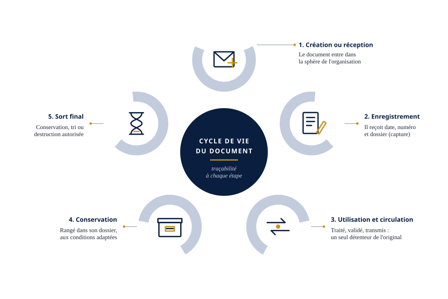
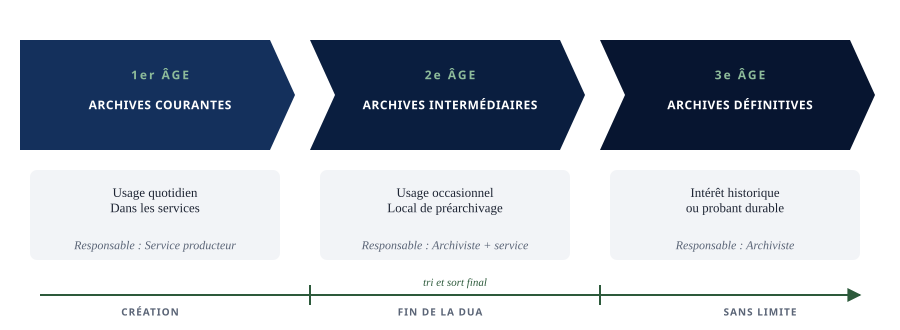
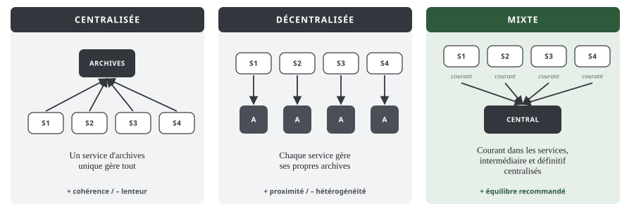
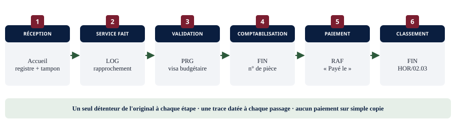

::: situation
Chez un distributeur de matériel informatique, une facture fournisseur de 18 000 euros a été payée deux fois. L'enquête interne révèle que l'original papier est passé par quatre bureaux, qu'une copie scannée a été transmise en parallèle par courriel et que personne ne savait, à un instant donné, qui détenait le document ni à quelle étape il se trouvait.

Le problème n'était pas le classement final. Il se situait bien avant : dans le **parcours** du document. C'est ce parcours que nous allons maîtriser.
:::

::: objectifs
- Décrire les étapes du cycle de vie d'un document, de sa création à son sort final.
- Appliquer la théorie des trois âges pour situer un document.
- Choisir un mode d'organisation adapté : centralisé, décentralisé ou mixte.
- Mettre en place des registres et des fiches qui assurent la traçabilité.
:::

## Les étapes de la vie d'un document

Tout document d'activité suit un parcours. Le connaître permet d'intervenir au bon moment : il est plus simple de bien nommer un fichier au moment où on l'enregistre que d'identifier, cinq ans plus tard, un fichier appelé « scan_0034.pdf ».

{width=78%}

**1. Création ou réception.** Le document est rédigé en interne (un contrat, une note, un bon de commande) ou reçu de l'extérieur (une facture, un courrier, un courriel). C'est le moment où il entre dans la sphère de l'organisation.

**2. Enregistrement (ou capture).** Le document est identifié et rattaché à son contexte : on lui attribue une date, un numéro, un dossier. Pour un courrier, c'est l'inscription au registre d'arrivée. Pour un fichier, c'est l'enregistrement dans le bon répertoire, sous un nom normalisé. La norme ISO 15489-1:2016 parle de **capture** : l'acte qui fait d'une information un document géré.

**3. Utilisation et circulation.** Le document est traité, validé, transmis, annoté. C'est la phase la plus active et la plus risquée : copies multiples, pertes, modifications non tracées.

**4. Conservation.** Une fois traité, le document est rangé dans son dossier et conservé tant qu'il est utile, dans des conditions adaptées.

**5. Sort final.** À l'échéance de sa durée de conservation, le document est soit **détruit** de façon autorisée et sécurisée, soit **versé** dans un fonds d'archives définitives, soit **trié** (une partie est conservée, l'autre éliminée). Le chapitre 6 détaille cette étape.

::: exemple
**Le bon de commande d'une entreprise de BTP.** Créé par le chef de chantier (création), il reçoit un numéro dans le logiciel d'achat (enregistrement), est validé par le conducteur de travaux puis transmis au fournisseur (circulation), classé dans le dossier du chantier (conservation) et détruit dix ans après la clôture comptable, si la règle applicable le permet (sort final).
:::

## La théorie des trois âges

Formulée en France par Yves Pérotin au début des années 1960, la théorie des trois âges reste l'outil le plus simple pour décider **où** et **comment** conserver un document. Elle repose sur une idée : la fréquence d'utilisation d'un document diminue avec le temps, et son mode de gestion doit évoluer avec elle.

{width=100%}

### Les archives courantes (premier âge)

Ce sont les documents **utilisés régulièrement** pour le traitement des affaires en cours. Ils restent dans les bureaux ou dans les espaces numériques de travail des services, à portée de main.

*Exemples :* les factures de l'exercice en cours, les dossiers des salariés actifs, les contrats en vigueur, le dossier d'un projet en exécution.

**Qui en est responsable ?** Le service producteur, qui doit néanmoins appliquer les règles communes (plan de classement, nommage).

### Les archives intermédiaires (deuxième âge)

Ce sont les documents qui **ne servent plus au quotidien** mais qui doivent être conservés pour des raisons administratives, juridiques ou financières. On les consulte occasionnellement : contrôle, audit, litige, demande d'un ancien salarié.

*Exemples :* les pièces comptables des exercices clos, les dossiers de projets terminés mais encore auditables, les dossiers du personnel ayant quitté l'organisation.

Ces documents sont transférés dans un **local de préarchivage** ou un espace numérique dédié, sous la responsabilité de l'archiviste, mais restent à la disposition du service qui les a produits. La durée pendant laquelle ils sont conservés à ce titre s'appelle la **durée d'utilité administrative (DUA)**.

### Les archives définitives (troisième âge)

Ce sont les documents qui, à l'issue de leur DUA, présentent un **intérêt historique, patrimonial ou de preuve à long terme**. Ils sont conservés sans limitation de durée.

*Exemples :* les statuts et leurs modifications, les procès-verbaux des assemblées générales et des conseils d'administration, les rapports annuels, les documents fondateurs d'un programme emblématique, les photographies d'événements marquants.

| Critère | Courantes | Intermédiaires | Définitives |
|---|---|---|---|
| Fréquence d'utilisation | Quotidienne ou hebdomadaire | Occasionnelle | Rare, recherche ou preuve |
| Lieu de conservation | Bureaux, espace de travail numérique | Local de préarchivage, espace d'archivage | Local d'archives définitives, système d'archivage pérenne |
| Responsable principal | Service producteur | Archiviste, en lien avec le service | Archiviste |
| Durée | Pendant le traitement de l'affaire | DUA fixée par le tableau de gestion | Illimitée |
| Accès | Équipe du service | Service producteur sur demande | Selon les règles de communication |

: Comparaison des trois âges

::: note
La théorie des trois âges est complétée, depuis les années 1990, par le modèle du **records continuum** développé en Australie, qui insiste sur la continuité de la gestion plutôt que sur des étapes successives. Pour une organisation qui débute, les trois âges restent le point de départ le plus opérationnel.
:::

## Organiser la gestion : centralisée, décentralisée ou mixte

Une fois le cycle compris, reste à décider **qui fait quoi**. Trois modèles existent.

### La gestion centralisée

Tous les documents, dès qu'ils ne sont plus d'usage quotidien, sont gérés par un service d'archives unique. **Avantages :** homogénéité, contrôle, expertise concentrée. **Limites :** délais de communication, risque de goulot d'étranglement, éloignement des services.

### La gestion décentralisée

Chaque service gère ses propres archives, y compris intermédiaires. **Avantages :** proximité et rapidité. **Limites :** pratiques hétérogènes, doublons, absence de vision globale, risque élevé de perte lors des départs.

### La gestion mixte

C'est le modèle le plus répandu et, pour la plupart des PME et des ASBL, le plus réaliste. Les **archives courantes** restent dans les services, qui appliquent des règles communes définies par le responsable des archives ; les **archives intermédiaires et définitives** sont centralisées.

{width=100%}

::: horizon
L'Organisation Horizon fonctionnait de manière décentralisée « par défaut », sans règles. Après analyse, Mireille et Jonas retiennent une **gestion mixte** : chaque service conserve ses dossiers courants selon un plan commun ; Esther, désignée **référente archives**, gère le local central et l'espace numérique d'archivage. Les deux antennes envoient leurs documents intermédiaires au siège deux fois par an.
:::

## Le circuit de circulation des documents

Un **circuit documentaire** décrit le chemin qu'emprunte un type de document : qui le reçoit, qui le traite, qui le valide, où il est rangé. Le formaliser évite les pertes, les doublons et les traitements multiples, comme le double paiement de notre situation de départ.

Pour décrire un circuit, posez cinq questions :

1. **Qui** reçoit ou crée le document ?
2. **Quelles étapes** de traitement et de validation sont nécessaires ?
3. **Qui détient l'original** à chaque étape ? (Une seule réponse possible.)
4. **Quelle trace** prouve le passage à chaque étape (visa, date, enregistrement) ?
5. **Où** le document est-il rangé à la fin, et sous quelle référence ?

::: definition
**Original.** Document dans sa forme première, revêtu des signes de validation (signature, cachet, signature électronique) qui lui donnent sa valeur de preuve.

**Copie.** Reproduction d'un original. Une copie peut circuler pour information ; l'original suit un chemin unique et contrôlé.
:::

## Registres d'entrée et de sortie

Le **registre d'arrivée** (ou d'entrée) enregistre chaque document reçu ; le **registre de départ** (ou de sortie), chaque document expédié. Tenu sur papier ou sous tableur, il constitue la première pierre de la traçabilité.

| N° d'ordre | Date de réception | Expéditeur | Objet | Type | Destinataire interne | Suite donnée | Référence de classement |
|---|---|---|---|---|---|---|---|
| 2026-0412 | 03/03/2026 | Fournisseur Delta | Facture n° 7781 | Facture | FIN (Patrick) | Payée le 18/03 | HOR/02.03/2026 |
| 2026-0413 | 03/03/2026 | Fondation Alizé | Avenant à la convention | Courrier | DIR (Mireille) | Signé le 10/03 | HOR/05.01/2026 |

: Extrait d'un registre d'arrivée (exemple fictif)

Quelques règles simples rendent le registre efficace : numérotation continue sans saut, inscription **le jour même**, aucune rature (on barre d'un trait et on corrige en paraphant), et report du numéro d'ordre sur le document lui-même (tampon ou mention).

## Fiches de prêt et de consultation

Dès qu'un document quitte son emplacement, une trace doit le remplacer. La **fiche de prêt** (ou fantôme) est placée à l'emplacement du dossier sorti. Elle indique : la référence du dossier, le nom de l'emprunteur, son service, la date de sortie, la date de retour prévue, la signature de l'emprunteur et celle de l'archiviste au retour.

La **fiche de consultation** concerne les documents consultés sur place sans sortie. Elle permet de savoir qui a eu accès à quoi, ce qui est essentiel pour les documents confidentiels (chapitre 8). Un modèle figure en **annexe D**.

## La traçabilité documentaire

La **traçabilité** est la capacité de reconstituer l'historique d'un document : qui l'a créé, reçu, modifié, consulté, déplacé, et quand. Elle repose sur l'ensemble des outils vus dans ce chapitre :

- le **registre d'arrivée et de départ** pour les entrées et sorties ;
- le **visa** ou la mention de validation à chaque étape du circuit ;
- les **fiches de prêt et de consultation** pour les mouvements ;
- dans un environnement numérique, le **journal des événements** (historique automatique d'un logiciel de GED).

::: exemple
Dans un cabinet comptable, chaque dossier client porte une fiche de suivi agrafée à l'intérieur de la couverture : date d'ouverture, collaborateurs intervenus, dates de transmission au client, date d'archivage. En cas de contestation, le cabinet reconstitue l'historique en quelques minutes.
:::

## Cas pratique : le circuit d'une facture fournisseur

::: cas
**Contexte.** L'Organisation Horizon reçoit chaque mois environ 120 factures fournisseurs, par courrier, par courriel et parfois remises en main propre aux coordinateurs de projets. Plusieurs factures ont été égarées et une a été payée deux fois.

**Travail demandé.**

1. Dessinez le circuit idéal d'une facture fournisseur, de sa réception à son archivage.
2. Indiquez, pour chaque étape, le détenteur de l'original et la trace laissée.
3. Proposez deux contrôles qui empêchent un double paiement.
:::

::: corrige
**Proposition de circuit.**

{width=100%}

| Étape | Acteur | Détenteur de l'original | Trace |
|---|---|---|---|
| 1. Réception centralisée | Accueil / Esther | Accueil | N° au registre d'arrivée, tampon « Reçu le » |
| 2. Rapprochement avec le bon de commande et le bon de réception | Logistique (LOG) | LOG | Visa « Service fait » daté |
| 3. Validation budgétaire | Coordinateur du projet (PRG) | PRG | Visa et code budgétaire |
| 4. Comptabilisation | Comptable (FIN) | FIN | N° de pièce comptable |
| 5. Paiement | RAF (Jonas) | FIN | Référence du virement, tampon « Payé le » |
| 6. Classement | Comptable | Dossier FIN | Référence HOR/02.03/année/n° |

**Contrôles contre le double paiement :** (1) toute facture est enregistrée une seule fois au registre, et le logiciel comptable bloque la saisie d'un même couple « fournisseur + numéro de facture » ; (2) le tampon « Payé le… » est apposé sur l'original au moment du paiement, et aucun paiement n'est effectué sur copie ou sur scan reçu par courriel sans vérification préalable au registre.
:::

## Erreurs fréquentes à éviter

::: attention
- **Laisser plusieurs portes d'entrée sans registre.** Courrier, courriel, remise en main propre : tout doit converger vers un enregistrement unique.
- **Faire circuler l'original et des copies en parallèle.** On ne sait plus quelle version fait foi.
- **Sortir un dossier sans fiche de prêt.** Le dossier « emprunté pour une heure » disparaît pour des mois.
- **Garder indéfiniment les archives intermédiaires dans les bureaux.** Elles encombrent et se mêlent aux dossiers actifs.
- **Confondre centralisation et désengagement des services.** Même dans un modèle centralisé, les services restent responsables de leurs documents courants.
:::

## À retenir

::: retenir
- Le cycle de vie d'un document comprend la **création ou réception**, l'**enregistrement**, l'**utilisation**, la **conservation** et le **sort final**.
- La théorie des **trois âges** distingue archives **courantes**, **intermédiaires** et **définitives**.
- La **DUA** est la durée pendant laquelle un document doit être conservé pour des raisons administratives ou légales.
- La **gestion mixte** combine la proximité des services et le contrôle d'un responsable central.
- Registres, visas, fiches de prêt et journaux d'événements assurent la **traçabilité**.
:::

## QCM

::: qcm
**1.** Les dossiers des salariés qui ont quitté l'organisation depuis deux ans sont :\
a) des archives courantes ;\
b) des archives intermédiaires ;\
c) des archives définitives.

**2.** Que signifie DUA ?\
a) Durée d'utilisation automatique.\
b) Durée d'utilité administrative.\
c) Délai unique d'archivage.

**3.** Dans un circuit documentaire bien conçu, l'original :\
a) est photocopié à chaque étape ;\
b) suit un chemin unique, avec un seul détenteur à chaque instant ;\
c) reste à l'accueil pendant que les copies circulent.

**4.** La fiche de prêt sert à :\
a) remplacer définitivement un dossier perdu ;\
b) indiquer qui a emprunté un dossier et quand il doit revenir ;\
c) autoriser la destruction d'un document.

**5.** Le modèle de gestion le plus adapté à la plupart des PME et ASBL est :\
a) la gestion entièrement décentralisée ;\
b) la gestion mixte ;\
c) l'absence de règle, pour gagner en souplesse.

**6.** Laquelle de ces pratiques ne contribue **pas** à la traçabilité ?\
a) Le registre d'arrivée.\
b) Le journal des événements d'une GED.\
c) L'envoi d'une facture en copie à tous les services.
:::

::: corrige
**Corrigé expliqué**

**1. b.** Ces dossiers ne servent plus au quotidien mais doivent être conservés pour répondre à d'éventuelles demandes ou contrôles.\
**2. b.** La durée d'utilité administrative est fixée par le tableau de gestion (chapitre 6).\
**3. b.** Un détenteur unique de l'original à chaque étape évite les pertes et les traitements multiples.\
**4. b.** La fiche de prêt matérialise l'absence du dossier et identifie l'emprunteur.\
**5. b.** La gestion mixte concilie proximité des services et cohérence d'ensemble.\
**6. c.** Multiplier les copies brouille la traçabilité et favorise les doubles traitements.
:::
