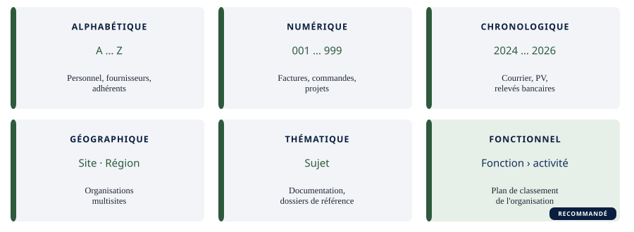

::: situation
Vous héritez d'un bureau. Dans les armoires : des classeurs étiquetés « Divers 2019 », « À traiter », « Important », des chemises sans titre, des copies en triple de certaines lettres et, au fond, deux cartons marqués « Jonathan » du nom d'un ancien collaborateur. Par où commencer ?

Ce chapitre répond à cette question avec une méthode qui fonctionne aussi bien pour un bureau que pour une organisation entière.
:::

::: objectifs
- Organiser une collecte documentaire et identifier les documents et leurs producteurs.
- Trier les documents selon des critères explicites.
- Choisir la méthode de classement adaptée à chaque série de documents.
- Concevoir, codifier et documenter un plan de classement.
:::

## La collecte documentaire

La **collecte** consiste à rassembler les documents dispersés pour les prendre en charge. Elle peut être ponctuelle (reprise d'un arriéré, départ d'un collaborateur) ou régulière (versements annuels des services). Dans les deux cas, elle se prépare.

1. **Annoncer** la collecte : les services doivent savoir pourquoi, quand et comment.
2. **Repérer** les gisements : bureaux, armoires, caves, greniers, ordinateurs, serveurs, messageries, clés USB, espaces de stockage en ligne.
3. **Ne rien déplacer avant d'avoir noté la provenance.** Un carton sans origine connue perd une part de sa valeur.
4. **Conditionner provisoirement** : chaque lot reçoit une étiquette (service, bureau, date de collecte).
5. **Enregistrer** la prise en charge dans un registre ou un tableau.

::: attention
Lors du départ d'un collaborateur, la collecte doit intervenir **avant** la désactivation de ses comptes informatiques. Une messagerie supprimée emporte avec elle des validations, des échanges avec les partenaires et parfois des contrats.
:::

## Identifier les documents et les services producteurs

Identifier un document, c'est répondre à quatre questions : **qui** l'a produit ou reçu, **quoi** (sa nature), **quand** (ses dates), **pourquoi** (l'activité qu'il documente).

Identifier le **producteur** est la première étape, car le principe de respect des fonds interdit de mélanger des documents de producteurs différents. Dans une organisation, on raisonne souvent par **service producteur** : la comptabilité produit les pièces comptables, les ressources humaines produisent les dossiers du personnel. Mais attention : un même document peut exister en plusieurs exemplaires. L'exemplaire qui fait foi est celui détenu par le service **responsable de l'activité** ; on parle d'**exemplaire principal**. Les autres sont des **exemplaires secondaires**, souvent éliminables plus tôt.

::: exemple
La convention de financement signée avec un bailleur circule entre la direction, la comptabilité et le coordinateur du projet. L'exemplaire principal, original signé, est conservé dans le dossier de la fonction « Partenariats et financements ». Les copies des autres services sont des exemplaires de travail.
:::

## Les méthodes de tri

**Trier**, c'est séparer ce qui doit être conservé de ce qui peut être éliminé, et regrouper ce qui va ensemble. On élimine sans hésitation :

- les **doubles** et copies multiples d'un document dont l'original est conservé ;
- les **documents de pure information** reçus en masse (publicités, catalogues périmés, circulaires générales disponibles ailleurs) ;
- les **brouillons** et versions intermédiaires lorsque la version finale validée existe, sauf s'ils portent des annotations décisionnelles ;
- les **papiers de corbeille** : enveloppes vides, bordereaux de transmission sans contenu.

On ne détruit **jamais** pendant le tri ce qui relève d'une obligation de conservation : pièces comptables, contrats, dossiers du personnel, documents de gouvernance. Leur sort sera fixé par le tableau de gestion (chapitre 6). En cas de doute, on conserve et on signale.

::: definition
**Tri.** Opération qui consiste à séparer, au sein d'un ensemble, les documents à conserver de ceux à éliminer, selon des critères définis.

**Élimination.** Destruction autorisée et documentée de documents dont la durée de conservation est échue. Ne pas confondre avec le simple fait de « jeter ».
:::

## Les six méthodes de classement

Une fois triés, les documents doivent être ordonnés. Il n'existe pas de méthode universelle : chaque série de documents appelle la méthode qui correspond à **la question que se posera l'utilisateur** au moment de la recherche.

{width=100%}

### Le classement alphabétique

Les documents sont rangés selon l'ordre des lettres d'un nom (personne, organisme, lieu). **Usage :** dossiers du personnel, dossiers fournisseurs, dossiers d'adhérents. **Règles :** classer au nom de famille puis au prénom, fixer une règle pour les particules et les noms composés et l'écrire. **Limite :** les homonymes et les changements de nom.

### Le classement numérique

Chaque dossier reçoit un numéro d'ordre continu. **Usage :** factures, bons de commande, dossiers de projets. **Atout :** extensible à l'infini et plus confidentiel (un numéro ne révèle pas un nom). **Limite :** exige un index pour retrouver le numéro à partir d'un nom.

### Le classement chronologique

Les documents sont rangés selon leur date. **Usage :** courriers, procès-verbaux, relevés bancaires, registres. On le combine presque toujours avec une autre méthode : dans le dossier d'un fournisseur (alphabétique), les factures sont rangées par date.

### Le classement géographique

Les documents sont ordonnés par lieu : pays, province, ville, site. **Usage :** organisations multisites, projets répartis sur plusieurs zones, dossiers immobiliers.

### Le classement thématique (ou par matières)

Les documents sont regroupés par sujet : « Assurances », « Véhicules », « Informatique ». **Usage :** documentation et dossiers de référence. **Limite :** il est subjectif ; deux personnes ne rangent pas un même document sous le même thème.

### Le classement fonctionnel

Les documents sont regroupés selon la **fonction** et l'**activité** qui les ont produits : « Gérer les ressources humaines > Recruter > Dossiers de recrutement ». C'est la méthode recommandée par les pratiques internationales de gestion des documents d'activité, car les fonctions d'une organisation sont plus **stables** que son organigramme. Un service peut être renommé ou fusionné ; la fonction « payer les fournisseurs » demeure.

## Élaborer un plan de classement

Le **plan de classement** est la structure logique, hiérarchisée et codifiée qui organise l'ensemble des documents d'une organisation. Il s'applique au papier comme au numérique : le même plan sert à nommer les rayonnages et les dossiers partagés.

**Démarche en six étapes :**

1. **Recenser les fonctions** de l'organisation à partir des statuts, de l'organigramme et d'entretiens avec chaque service.
2. **Décomposer** chaque fonction en activités, puis en types de dossiers.
3. **Limiter la profondeur** à trois ou quatre niveaux : au-delà, le plan devient inutilisable.
4. **Codifier** chaque rubrique.
5. **Tester** le plan avec un échantillon réel de documents et avec des utilisateurs.
6. **Valider et diffuser** : le plan est approuvé par la direction, puis expliqué aux équipes.

::: horizon
**Le plan de classement d'Horizon (extrait).** Esther, accompagnée de Jonas, a mené six entretiens d'une heure avec les responsables de service. Le plan retenu est **fonctionnel** : il ne reprend pas l'organigramme, mais les grandes missions de l'ASBL.

| Code | Fonction | Exemples de sous-rubriques |
|---|---|---|
| 01 | Gouvernance et direction | 01.01 Statuts · 01.02 Assemblée générale · 01.03 Conseil d'administration · 01.04 Stratégie |
| 02 | Finances et comptabilité | 02.01 Budgets · 02.02 Comptabilité générale · 02.03 Factures fournisseurs · 02.05 Banque · 02.07 Audits |
| 03 | Ressources humaines | 03.01 Recrutement · 03.02 Dossiers individuels · 03.03 Paie et déclarations sociales · 03.04 Formation |
| 04 | Programmes et projets | 04.01 Conception · 04.02 Dossiers de projets · 04.03 Suivi-évaluation · 04.04 Bénéficiaires |
| 05 | Partenariats et financements | 05.01 Conventions de financement · 05.02 Rapports aux bailleurs · 05.03 Partenariats opérationnels |
| 06 | Logistique, achats et patrimoine | 06.01 Achats · 06.02 Contrats et baux · 06.03 Inventaire des biens · 06.04 Assurances |
| 07 | Communication | 07.01 Publications · 07.02 Presse et réseaux sociaux · 07.03 Photothèque · 07.04 Événements |

Le plan complet figure en **annexe B**. Remarquez que le service « Communication et Partenariats » alimente deux fonctions différentes (05 et 07) : le plan suit les activités, non les bureaux.
:::

### Exemple de plan pour une entreprise commerciale

| Code | Fonction | Exemples |
|---|---|---|
| 10 | Direction et affaires juridiques | Statuts, PV d'assemblée, contentieux, propriété intellectuelle |
| 20 | Finances, comptabilité, fiscalité | Comptabilité, factures, banques, déclarations fiscales |
| 30 | Ressources humaines | Recrutement, dossiers du personnel, paie, formation |
| 40 | Commercial et clients | Offres, contrats clients, réclamations |
| 50 | Achats et fournisseurs | Appels d'offres, contrats fournisseurs, commandes |
| 60 | Production, opérations, qualité | Procédures, contrôles qualité, maintenance |
| 70 | Systèmes d'information | Licences, contrats informatiques, sécurité |

: Plan de classement type pour une PME commerciale

## La codification

La **codification** attribue à chaque rubrique un code court, stable et univoque. Trois systèmes sont courants :

- **numérique décimal** : 02, 02.03, 02.03.01 (le plus lisible et le plus extensible) ;
- **alphanumérique** : FIN-FOU (finances, fournisseurs), plus parlant mais plus fragile en cas de réorganisation ;
- **mixte** : préfixe de l'organisation et code décimal, par exemple **HOR/02.03**.

Règles d'or : ne jamais **réutiliser** un code supprimé, prévoir des **réserves** (on ne numérote pas 01, 02, 03 jusqu'à 09 si l'on sait que d'autres fonctions apparaîtront) et tenir à jour la **table des codes**.

## L'organisation des dossiers

Un plan de classement s'incarne dans des dossiers. Un dossier bien constitué respecte quelques principes :

- **un dossier, une affaire** : un dossier par marché, par salarié, par projet, par exercice ;
- un **titre normalisé** qui reprend le code et l'objet : *HOR/04.02 · Projet Cap Emploi · 2025-2027* ;
- des **sous-dossiers** ordonnés de façon constante, toujours dans le même ordre ;
- l'ordre **chronologique** à l'intérieur des sous-dossiers, le document le plus récent au-dessus ou en dessous selon une règle unique ;
- l'**élimination des trombones et des élastiques** pour les dossiers destinés à être conservés longtemps (chapitre 5).

## Classer par domaine : repères pratiques

| Domaine | Méthode principale | Unité de classement | Point d'attention |
|---|---|---|---|
| Comptable | Chronologique et numérique | Exercice, journal, numéro de pièce | Le numéro de pièce relie la facture à l'écriture. |
| Financier | Chronologique | Compte bancaire, mois | Classer les relevés avec les rapprochements. |
| Administratif | Fonctionnel | Affaire ou activité | Éviter les dossiers « Divers ». |
| Juridique | Numérique et alphabétique | Contrat, contentieux | Conserver les originaux signés et les avenants ensemble. |
| Ressources humaines | Alphabétique ou matricule | Un dossier par salarié | Accès restreint, sous-dossiers distincts (contrat, paie, évaluation, santé). |
| Projets | Numérique par projet | Un dossier par projet | Tout justificatif rattaché au code du projet et du bailleur. |

: Repères de classement par domaine

## Cas pratique : classer trente documents

::: cas
**Contexte.** Esther a collecté trente documents dans le bureau d'un coordinateur qui a quitté l'Organisation Horizon. À l'aide du plan d'Horizon (codes 01 à 07), attribuez à chaque document sa rubrique, ou décidez de l'éliminer comme doublon ou document sans valeur.

| N° | Document | N° | Document |
|---|---|---|---|
| 1 | Statuts modifiés en 2022 (copie) | 16 | Contrat de bail de l'antenne Est |
| 2 | PV de l'AG de 2025 (original) | 17 | Facture du traiteur, atelier de juin |
| 3 | Budget prévisionnel 2026 | 18 | Liste de présence, formation cuisine |
| 4 | Relevé bancaire de mars | 19 | Rapport narratif semestriel au bailleur |
| 5 | Facture d'achat d'ordinateurs | 20 | Catalogue d'un fournisseur de mobilier |
| 6 | CV d'un candidat retenu | 21 | Photos de la remise de diplômes |
| 7 | Contrat de travail d'une formatrice | 22 | Communiqué de presse du lancement |
| 8 | Bulletin de paie de janvier (copie) | 23 | Police d'assurance des véhicules |
| 9 | Attestation de formation d'un salarié | 24 | Grille d'évaluation des bénéficiaires |
| 10 | Note conceptuelle du projet Cap Emploi | 25 | Convention avec un centre de formation |
| 11 | Convention de financement Fondation Alizé | 26 | Rapport de l'auditeur externe |
| 12 | Fiches d'inscription des bénéficiaires | 27 | Troisième copie de la facture n° 5 |
| 13 | Tableau de suivi des indicateurs | 28 | Invitation à un séminaire externe passé |
| 14 | Bon de commande de fournitures | 29 | Ordre du jour du conseil d'administration |
| 15 | Inventaire des biens de l'antenne Est | 30 | Plan stratégique 2025-2029 |

: Les trente documents à classer
:::

::: corrige
| Rubrique | Documents | Commentaire |
|---|---|---|
| 01 Gouvernance | 1, 2, 29, 30 | Le n° 1 est une copie : vérifier que l'original existe en 01.01, puis conserver ou éliminer la copie. |
| 02 Finances | 3, 4, 5, 17, 26 | Le n° 17 est rattaché au code du projet concerné. Le n° 26 va en 02.07 Audits. |
| 03 Ressources humaines | 6, 7, 8, 9 | Dossier individuel confidentiel. Le n° 8 est une copie : l'exemplaire principal est en 03.03 Paie. |
| 04 Programmes | 10, 12, 13, 18, 24 | Les n° 12 et 24 contiennent des données personnelles : accès restreint. |
| 05 Partenariats | 11, 19, 25 | Le n° 11 est l'original : il doit être sécurisé immédiatement. |
| 06 Logistique | 14, 15, 16, 23 | Le bail (16) et l'assurance (23) sont des contrats à suivre jusqu'à échéance. |
| 07 Communication | 21, 22 | Photos à décrire (date, lieu, événement, personnes, droit à l'image). |
| À éliminer | 20, 27, 28 | Catalogue périmé, doublon d'une facture dont l'original est en comptabilité, invitation passée. |

**Point de vigilance.** Le classement par **fonction** a permis de répartir les documents d'un même bureau entre sept rubriques. Classer « par bureau » aurait recréé le désordre initial.
:::

## Erreurs fréquentes à éviter

::: attention
- **Créer un dossier « Divers ».** Il devient vite le plus gros dossier de l'organisation.
- **Calquer le plan sur l'organigramme.** À la première réorganisation, le plan devient obsolète.
- **Multiplier les niveaux.** Au-delà de quatre niveaux, plus personne ne s'y retrouve.
- **Trier en détruisant des pièces probantes.** En cas de doute, on conserve et on signale.
- **Adopter un plan sans le tester.** Un plan qui ne résiste pas à cinquante documents réels ne résistera pas à cinquante mille.
:::

## À retenir

::: retenir
- La **collecte** se prépare : annoncer, repérer, noter la provenance, conditionner, enregistrer.
- Le **tri** élimine les doubles et documents sans valeur, jamais les pièces probantes.
- Six méthodes de classement : **alphabétique, numérique, chronologique, géographique, thématique, fonctionnel**. On les combine.
- Le **plan de classement fonctionnel** est le plus stable. Il s'applique au papier comme au numérique.
- La **codification** doit être courte, stable, extensible, et ne jamais réutiliser un code supprimé.
:::

## QCM

::: qcm
**1.** Pourquoi préférer un plan de classement fonctionnel ?\
a) Parce qu'il suit l'organigramme.\
b) Parce que les fonctions sont plus stables que les structures.\
c) Parce qu'il est plus court.

**2.** Quelle méthode convient le mieux aux dossiers du personnel ?\
a) Alphabétique ou par matricule.\
b) Géographique.\
c) Thématique.

**3.** Lors d'un tri, une facture originale de l'exercice précédent :\
a) peut être détruite si elle est numérisée ;\
b) est conservée et classée, son sort étant fixé par le tableau de gestion ;\
c) est rangée dans « Divers ».

**4.** Un code de rubrique supprimé :\
a) peut être réattribué à une nouvelle rubrique ;\
b) ne doit jamais être réutilisé ;\
c) doit être remplacé par un code alphabétique.

**5.** L'exemplaire principal d'un document est :\
a) le plus récent ;\
b) celui détenu par le service responsable de l'activité ;\
c) la copie numérisée.

**6.** Combien de niveaux hiérarchiques recommande-t-on pour un plan de classement ?\
a) Un seul.\
b) Trois ou quatre.\
c) Autant que nécessaire, sans limite.
:::

::: corrige
**Corrigé expliqué**

**1. b.** Une fonction (payer, recruter, rendre compte) survit aux réorganisations.\
**2. a.** On recherche un salarié par son nom ou son matricule.\
**3. b.** Le tri n'est pas le moment de décider du sort final des pièces probantes ; la numérisation ne suffit pas toujours à remplacer l'original.\
**4. b.** Réutiliser un code crée des confusions avec les documents déjà classés sous l'ancien sens.\
**5. b.** Il fait foi ; les autres exemplaires sont secondaires.\
**6. b.** Trois ou quatre niveaux concilient précision et facilité d'usage.
:::
