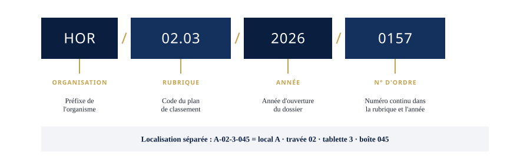

::: situation
« Tu te souviens du contrat avec le transporteur, celui de l'année où on a ouvert l'antenne ? » La question tombe pendant une réunion. Personne ne connaît le nom exact du transporteur, ni l'année précise. Le contrat existe, il est même correctement classé. Mais sans index ni inventaire, il faut ouvrir vingt boîtes pour le trouver.

La recherche documentaire part toujours d'une **information incomplète**. Ce chapitre vous apprend à construire les outils qui transforment un souvenir vague en une adresse précise.
:::

::: objectifs
- Indexer des documents avec des mots-clés pertinents et contrôlés.
- Distinguer et produire les principaux instruments de recherche.
- Attribuer une cote unique et une localisation à chaque unité.
- Organiser la recherche, la communication et le suivi des consultations.
:::

## L'indexation : donner des points d'accès

**Indexer**, c'est associer à un document des **termes** qui décrivent son contenu et permettent de le retrouver par d'autres chemins que son classement. Le plan de classement offre un seul chemin (la fonction) ; l'index en ouvre plusieurs : un nom de personne, un lieu, un sujet, une date.

On distingue quatre grandes familles de termes d'indexation :

- les **noms de personnes** (physiques ou morales) : *Fondation Alizé*, *Delta Transports* ;
- les **noms de lieux** : *Antenne Est*, *Kinshasa*, *Lyon* ;
- les **matières** (sujets) : *formation professionnelle*, *assurance*, *véhicule* ;
- les **types de documents** : *contrat*, *procès-verbal*, *facture*.

### Choisir les mots-clés

Un bon mot-clé est **précis**, **normalisé** et **utile à la recherche**. Quelques règles pratiques :

1. Utiliser le **singulier** et la forme la plus courante : *contrat*, pas *contrats* ou *contractualisation*.
2. Écrire les noms propres sous une **forme unique** : choisir entre *Fondation Alizé* et *Fdt Alizé*, et s'y tenir.
3. Préférer le terme **spécifique** au terme général : *bail* plutôt que *contrat* lorsque c'est un bail.
4. Limiter le nombre de mots-clés : trois à six suffisent généralement.
5. S'appuyer sur une **liste d'autorité** ou un **thésaurus** maison.

::: definition
**Liste d'autorité.** Liste fermée des formes retenues pour les noms de personnes, d'organismes et de lieux.

**Thésaurus.** Vocabulaire contrôlé et structuré qui indique, pour chaque notion, le terme retenu (descripteur), les termes rejetés (synonymes) et les relations entre termes (générique, spécifique, associé).
:::

::: exemple
Dans le thésaurus d'une ASBL : *Formation professionnelle* (descripteur). Employé pour : *apprentissage*, *stage qualifiant*. Terme générique : *Insertion*. Termes spécifiques : *Formation en alternance*, *Formation qualifiante*. Celui qui cherche « stage qualifiant » est renvoyé au bon terme.
:::

## Les instruments de recherche

Un **instrument de recherche** est un outil qui décrit des archives pour permettre de les retrouver et de les comprendre. Les principaux sont présentés ci-dessous, du plus général au plus détaillé.

| Instrument | Ce qu'il décrit | Niveau de détail | Usage typique |
|---|---|---|---|
| **État des fonds** | L'ensemble des fonds conservés | Très général | Vue d'ensemble d'un service d'archives |
| **Répertoire** | Les dossiers d'un fonds, dans l'ordre du classement | Dossier | Liste des boîtes et dossiers d'un service |
| **Inventaire** | Les dossiers et leur contenu, avec analyse | Dossier ou pièce | Fonds important, souvent consulté |
| **Bordereau de versement** | Les documents transférés par un service | Dossier | Prise en charge des archives intermédiaires |
| **Index** | Les noms, lieux, sujets, renvoyant aux cotes | Terme | Accès transversal |
| **Registre** | Des opérations ou des documents, dans l'ordre d'enregistrement | Opération | Courrier, prêts, éliminations |

: Les principaux instruments de recherche

Dans une PME ou une ASBL, un **répertoire** tenu sous tableur, enrichi de mots-clés, joue souvent à lui seul le rôle de répertoire, d'inventaire et d'index. C'est l'outil que nous construirons en fin de chapitre.

## La description archivistique

**Décrire**, c'est rédiger pour chaque unité (fonds, série, dossier, pièce) une notice qui permet de l'identifier et de comprendre son contexte. La norme internationale de référence est **ISAD(G)**, publiée par le Conseil international des archives (ICA), dont la deuxième édition date de 2000. Elle repose sur quatre principes : la description **du général au particulier**, des informations **adaptées au niveau** décrit, des **liens** entre niveaux et la **non-répétition** des informations.

Pour un usage interne, sept éléments suffisent à une notice de dossier utile :

| Élément | Question | Exemple |
|---|---|---|
| Cote | Quelle est son adresse ? | HOR/05.01/2022/003 |
| Intitulé | De quoi s'agit-il ? | Convention de financement Fondation Alizé, projet Cap Emploi |
| Dates extrêmes | Quelle période couvre-t-il ? | 2022-2025 |
| Producteur | Qui l'a constitué ? | Direction générale |
| Contenu | Que contient-il ? | Convention signée, deux avenants, correspondance |
| Volume et support | Combien, sous quelle forme ? | 1 chemise, 46 feuillets ; copie PDF |
| Conditions d'accès | Qui peut le consulter ? | Direction, RAF, auditeurs mandatés |

: Les éléments essentiels d'une notice

::: note
Les **dates extrêmes** sont la date du document le plus ancien et celle du document le plus récent du dossier. Elles s'écrivent sous la forme *2022-2025*.
:::

## La cotation et l'attribution de références uniques

La **cote** est l'identifiant unique attribué à une unité d'archives. Elle permet de la citer, de la localiser et de la remettre à sa place. Deux unités ne peuvent jamais partager la même cote.

Une bonne cote est **unique**, **stable** (elle ne change pas quand le document est déplacé), **courte** et **lisible**. Elle combine généralement le code du plan de classement, une année et un numéro d'ordre.

{width=92%}

::: horizon
Horizon adopte une cote en quatre segments : **HOR / 02.03 / 2026 / 0157**, soit l'organisation, la rubrique du plan, l'année et le numéro d'ordre continu dans la rubrique pour l'année. La cote est inscrite au crayon à papier en haut à droite des chemises, sur l'étiquette des boîtes et dans le nom des fichiers numériques correspondants.
:::

## La localisation des archives

La cote dit **ce qu'est** le document ; la localisation dit **où il se trouve**. Les séparer est une bonne pratique : si l'on déplace une boîte, on modifie la localisation dans le répertoire, sans toucher à la cote.

La localisation suit l'organisation physique du local : **local, travée, tablette, boîte**. À Horizon, la boîte rangée dans le local A, travée 02, tablette 3, en position 045 est localisée **A-02-3-045**. Pour les documents numériques, la localisation est le chemin d'accès dans l'espace d'archivage, idéalement doublé d'un identifiant permanent.

::: attention
Une localisation n'a de valeur que si elle est **tenue à jour**. Chaque déplacement de boîte doit être répercuté le jour même dans le répertoire.
:::

## La recherche documentaire

Une recherche efficace suit quatre étapes.

1. **Analyser la demande.** Reformuler avec le demandeur : quel document, quelle période, quelle personne, pour quel usage ? Une demande d'audit n'appelle pas la même réponse qu'une curiosité ponctuelle.
2. **Traduire en termes de recherche.** Identifier la fonction concernée (plan de classement), les mots-clés (index), la période (dates extrêmes).
3. **Interroger les instruments de recherche.** Commencer par le plus général, filtrer, croiser. Sous tableur : filtres sur la rubrique, recherche du mot-clé, tri par dates.
4. **Vérifier et restituer.** Contrôler que le document trouvé répond à la demande et noter la consultation.

::: exemple
Demande : « le contrat avec le transporteur de l'année d'ouverture de l'antenne ». Traduction : fonction *06 Logistique, achats*, sous-rubrique *06.02 Contrats*, mot-clé *transport*, période *année d'ouverture de l'antenne Est*. On consulte d'abord l'index des événements (ouverture : 2021), puis on filtre le répertoire sur 06.02, 2021, *transport*. Résultat : HOR/06.02/2021/004, localisé A-03-1-012.
:::

## Communication des documents et gestion des consultations

**Communiquer** un document, c'est le mettre à disposition d'une personne autorisée. La communication obéit à trois règles :

- **vérifier le droit d'accès** du demandeur selon le niveau de confidentialité du document (chapitre 8) ;
- **privilégier la consultation sur place** ou la transmission d'une copie pour les documents sensibles ou fragiles ;
- **tracer** chaque communication : qui, quoi, quand, sous quelle forme, avec quelle date de retour.

Pour les documents numériques, la communication passe par un **droit d'accès** temporaire ou par l'envoi d'une copie, jamais par le partage de l'original modifiable.

## Créer un registre de suivi documentaire sous Excel

Un tableur bien conçu suffit à gérer plusieurs milliers de dossiers. La clé est de **figer la structure** : chaque colonne a un rôle et un format, et des listes déroulantes empêchent les saisies fantaisistes.

| Colonne | Contenu | Format ou règle |
|---|---|---|
| A. Cote | Identifiant unique | Texte, format HOR/00.00/AAAA/0000, unicité contrôlée |
| B. Rubrique | Code du plan de classement | Liste déroulante |
| C. Intitulé | Titre du dossier | Texte libre, normalisé |
| D. Date début / E. Date fin | Dates extrêmes | Année ou date |
| F. Service producteur | DIR, FIN, RHU, PRG, LOG, COM | Liste déroulante |
| G. Support | Papier, numérique, mixte | Liste déroulante |
| H. Mots-clés | 3 à 6 termes séparés par « ; » | Selon la liste d'autorité |
| I. Confidentialité | Public, interne, confidentiel, secret | Liste déroulante |
| J. Localisation | Local-travée-tablette-boîte ou chemin | Texte |
| K. DUA | Durée d'utilité administrative | Nombre d'années, selon le tableau de gestion |
| L. Sort final | Conserver, détruire, trier | Liste déroulante |
| M. Date d'échéance | Fin de DUA | Formule : année de fin + DUA |
| N. Statut | En place, prêté, versé, éliminé | Liste déroulante |
| O. Observations | Remarques | Texte libre |

: Structure du registre de suivi documentaire

**Astuces de mise en œuvre :**

- transformez la plage en **tableau** (Insertion > Tableau) pour bénéficier des filtres automatiques ;
- créez les listes déroulantes avec **Données > Validation des données** ;
- contrôlez l'unicité de la cote avec une **mise en forme conditionnelle** de type « valeurs en double » ;
- calculez l'échéance, par exemple `=SI(ESTNUM(E2);E2+K2;"")` ;
- figez la première ligne et **protégez** les colonnes de formules.

Un classeur prêt à l'emploi, **Annexe_C_Registre_de_suivi_documentaire.xlsx**, est fourni avec l'ouvrage. Son principe est présenté en **annexe C**.

## Cas pratique : retrouver trois documents

::: cas
**Contexte.** Voici un extrait du répertoire d'Horizon. Trois demandes arrivent le même jour.

| Cote | Intitulé | Dates | Mots-clés | Localisation | Statut |
|---|---|---|---|---|---|
| HOR/01.02/2024/001 | AG ordinaire, dossier complet | 2024 | assemblée générale ; comptes ; élection | A-01-1-002 | En place |
| HOR/02.07/2023/002 | Audit externe des comptes 2022 | 2023 | audit ; commissaire ; rapport | A-02-4-031 | Prêté |
| HOR/03.02/2019/014 | Dossier individuel, MUKENDI Paul | 2019-2024 | contrat ; départ ; formateur | B-01-2-008 | En place |
| HOR/05.01/2022/003 | Convention Fondation Alizé, Cap Emploi | 2022-2025 | convention ; avenant ; Alizé | A-05-1-001 | En place |
| HOR/06.02/2021/004 | Contrat Delta Transports | 2021-2024 | transport ; véhicule ; antenne Est | A-03-1-012 | En place |

**Demandes.**

1. Le bailleur veut le second avenant de la convention du projet Cap Emploi.
2. Un ancien formateur demande une attestation reprenant ses dates d'emploi.
3. Le nouveau trésorier veut lire le rapport de l'auditeur sur les comptes 2022.

Pour chaque demande : trouvez la cote et la localisation, vérifiez la disponibilité, indiquez les précautions de communication.
:::

::: corrige
1. **HOR/05.01/2022/003**, A-05-1-001, en place. Le bailleur est partie à la convention : transmettre une **copie** de l'avenant, l'original restant au dossier. Tracer l'envoi.
2. **HOR/03.02/2019/014**, B-01-2-008, en place. Dossier **confidentiel** : seule Grâce (RH) le consulte. On ne communique pas le dossier à l'intéressé sans procédure ; on lui délivre une **attestation** établie à partir du contrat et des documents de sortie.
3. **HOR/02.07/2023/002**, A-02-4-031, statut **prêté**. Consulter la fiche de prêt pour identifier l'emprunteur et demander le retour, ou fournir une copie numérique si elle existe. Le trésorier est habilité, en tant qu'administrateur, à consulter le rapport.
:::

## Erreurs fréquentes à éviter

::: attention
- **Indexer avec des synonymes au hasard.** Sans vocabulaire contrôlé, la recherche devient une loterie.
- **Inscrire la localisation dans la cote.** Au premier déménagement, toutes les cotes sont fausses.
- **Attribuer une même cote à deux dossiers.** L'unicité est non négociable.
- **Communiquer un original sans trace.** Une sortie non enregistrée est un document perdu en puissance.
- **Laisser chacun modifier librement le registre Excel.** Protégez la structure et désignez un responsable.
:::

## À retenir

::: retenir
- L'**indexation** ouvre des accès transversaux : personnes, lieux, matières, types de documents.
- Les **instruments de recherche** vont de l'état des fonds à l'index, en passant par le répertoire et l'inventaire.
- **ISAD(G)** est la norme internationale de description archivistique.
- La **cote** identifie, la **localisation** situe : on les sépare.
- Un **registre sous Excel** bien structuré suffit à piloter les archives d'une PME ou d'une ASBL.
:::

## QCM

::: qcm
**1.** Un thésaurus sert à :\
a) classer les documents par date ;\
b) contrôler le vocabulaire d'indexation et relier les termes entre eux ;\
c) calculer les durées de conservation.

**2.** Quelle est la différence entre cote et localisation ?\
a) Aucune.\
b) La cote identifie l'unité ; la localisation indique où elle est rangée.\
c) La cote est réservée au numérique.

**3.** Que sont les dates extrêmes d'un dossier ?\
a) La date de création et la date de destruction.\
b) Les dates du document le plus ancien et du plus récent.\
c) Les dates d'ouverture du local d'archives.

**4.** ISAD(G) est :\
a) une norme internationale de description archivistique publiée par l'ICA ;\
b) un logiciel de GED ;\
c) une loi européenne.

**5.** Un document confidentiel demandé par une personne non habilitée :\
a) lui est communiqué si elle le demande poliment ;\
b) ne lui est pas communiqué, la demande est orientée selon la procédure ;\
c) lui est envoyé en copie par courriel.

**6.** Pour contrôler l'unicité des cotes dans Excel, on utilise :\
a) une mise en forme conditionnelle « valeurs en double » ;\
b) un tri alphabétique ;\
c) un graphique.
:::

::: corrige
**Corrigé expliqué**

**1. b.** Le thésaurus fixe les descripteurs, renvoie les synonymes et organise les relations entre termes.\
**2. b.** Séparer cote et localisation évite de recoter lors d'un déplacement.\
**3. b.** Elles bornent la période couverte par le dossier.\
**4. a.** Deuxième édition publiée par le Conseil international des archives en 2000.\
**5. b.** Le droit d'accès est vérifié avant toute communication.\
**6. a.** La mise en forme signale immédiatement toute cote saisie deux fois.
:::
