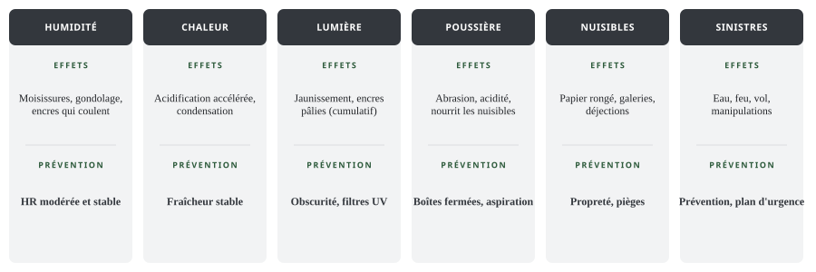
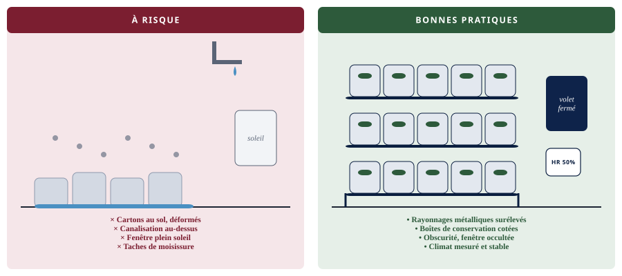

::: situation
Un lundi matin, après un week-end d'orage, l'équipe d'une coopérative découvre deux centimètres d'eau dans la cave où sont stockées les archives. Les cartons posés au sol ont absorbé l'eau. Trois semaines plus tard, des taches grises et une odeur de moisi envahissent la pièce. Les dossiers de prêts aux membres, encore nécessaires pour le recouvrement, sont en partie illisibles.

Aucun de ces dégâts n'était inévitable. La conservation des archives repose moins sur la réparation que sur la **prévention**.
:::

::: objectifs
- Identifier les facteurs de dégradation des documents et leurs signes.
- Distinguer conservation préventive et conservation curative.
- Choisir le matériel de conservation et aménager un local adapté.
- Prévenir les sinistres et préparer un plan d'urgence.
:::

## Les principes de la conservation

**Conserver**, c'est maintenir les documents dans un état qui garantit leur **intégrité** (ils ne sont ni altérés ni incomplets) et leur **lisibilité** dans le temps. Trois principes guident l'action :

1. **Prévenir plutôt que guérir** : agir sur l'environnement coûte beaucoup moins cher que restaurer.
2. **Stabiliser plutôt qu'optimiser** : des conditions moyennes mais stables valent mieux que des conditions idéales mais fluctuantes.
3. **Intervenir le moins possible** sur le document lui-même, et toujours de façon réversible.

### Conservation préventive et curative

| | Conservation préventive | Conservation curative |
|---|---|---|
| **Objet** | L'environnement et les pratiques | Le document lui-même |
| **Exemples** | Contrôle du climat, rayonnages, boîtes adaptées, entretien, formation | Séchage, désinfection, réparation, restauration |
| **Qui intervient ?** | L'archiviste et tout le personnel | Des professionnels spécialisés (restaurateurs) pour les interventions lourdes |
| **Coût** | Faible et régulier | Élevé et ponctuel |

: Préventif et curatif

::: definition
**Conservation préventive.** Ensemble des mesures indirectes qui visent à ralentir la dégradation des documents en agissant sur leur environnement et leur manipulation.

**Restauration.** Intervention directe sur un document endommagé pour en améliorer l'état. Elle doit être confiée à un restaurateur qualifié.
:::

## Les facteurs de dégradation

Les documents se dégradent sous l'effet de facteurs **internes** (la qualité du papier, l'acidité des encres) et surtout **externes** : climat, lumière, poussière, organismes vivants, sinistres et mauvaises manipulations.

{width=100%}

### L'humidité

C'est l'ennemi numéro un. Le papier est un matériau **hygroscopique** : il absorbe et rejette l'humidité de l'air. Une humidité relative élevée favorise les moisissures, gondole les documents, fait couler les encres et colle les photographies entre elles. Une humidité trop basse rend le papier cassant.

**Repères.** Les institutions d'archives recommandent généralement, pour le papier, une **humidité relative modérée et stable**, de l'ordre de 40 à 55 %. Le risque de moisissures devient important lorsque l'humidité dépasse durablement 65 % environ. Les valeurs de référence détaillées figurent dans la norme **ISO 11799:2024** relative aux exigences de stockage des documents d'archives et de bibliothèques.

**Mesurer :** un **thermohygromètre** enregistreur, placé à hauteur des documents, relevé chaque semaine.

### La température

La chaleur **accélère** les réactions chimiques qui dégradent le papier, en particulier l'acidification. Les variations brusques provoquent des cycles de dilatation et de condensation. **Repère courant :** une température **fraîche et stable**, souvent située entre 16 et 20 °C pour les magasins de papier, en évitant surtout les écarts journaliers importants. Dans les régions chaudes, l'objectif réaliste est d'abord la stabilité et la ventilation, avant une température basse coûteuse à maintenir.

### La lumière

La lumière, et surtout les rayons **ultraviolets** du soleil et de certains éclairages, jaunit le papier, fait pâlir les encres et fragilise les fibres. Ses effets sont **cumulatifs et irréversibles**. Les magasins d'archives doivent rester dans l'obscurité en dehors des interventions : fenêtres occultées ou filtrées, éclairage à détecteur de présence, documents toujours en boîtes.

### La poussière et les polluants

La poussière est abrasive, acide et attire l'humidité. Elle nourrit aussi les insectes et les moisissures. Les polluants atmosphériques (gaz d'échappement, fumées) acidifient le papier. **Prévention :** boîtes fermées, rayonnages à distance du sol, nettoyage régulier par aspiration plutôt que par balayage, pas de local d'archives contigu à un garage ou à une cuisine.

### Les nuisibles

Rongeurs, poissons d'argent, blattes, termites et vrillettes dévorent le papier, la colle et le carton. **Signes d'alerte :** déjections, trous, galeries, sciure, documents grignotés. **Prévention :** propreté, interdiction de nourriture dans le local, colmatage des ouvertures, pièges de surveillance. En cas d'infestation, faire appel à un professionnel et isoler les documents atteints.

### Les moisissures

Les moisissures sont des champignons microscopiques dont les spores sont présentes partout. Elles se développent dès que l'humidité et la chaleur le permettent, et attaquent le papier de façon irréversible. Elles présentent aussi un **risque pour la santé** des personnes qui manipulent les documents.

::: attention
**Face à des documents moisis :** porter des gants et un masque de protection respiratoire adapté ; isoler les documents dans un endroit sec et ventilé ; ne pas les enfermer humides dans des sacs plastiques ; abaisser l'humidité du local ; faire appel à un professionnel pour la désinfection. Ne jamais pulvériser de produits ménagers sur les documents.
:::

## Le matériel de conservation

Le choix du matériel est un investissement modeste au regard de la valeur des documents.

| Matériel | À privilégier | À éviter |
|---|---|---|
| **Boîtes** | Carton neutre ou de conservation, fermées, de format adapté | Cartons de récupération, cartons alimentaires, sacs plastiques |
| **Chemises** | Papier ou carton sans acide pour les dossiers à conservation longue | Chemises plastiques qui retiennent l'humidité |
| **Attaches** | Aucune, ou trombones en plastique ou inox pour les dossiers à conserver longtemps | Trombones et agrafes en acier qui rouillent, élastiques qui fondent |
| **Rayonnages** | Métal traité, premier niveau à au moins 10-15 cm du sol | Bois non traité, étagères bricolées, stockage au sol |
| **Étiquettes** | Étiquettes imprimées, cote lisible depuis l'allée | Inscriptions au feutre directement sur les documents |
| **Photographies** | Pochettes en papier neutre ou en polyester adapté | Albums adhésifs, contact direct entre clichés |

: Matériel de conservation

## Aménager un local d'archives

Le local idéal se rencontre rarement. Il s'agit donc de choisir le **moins mauvais** emplacement et de l'améliorer.

**Critères de choix de l'emplacement :**

- **ni cave, ni grenier**, ni sous une toiture-terrasse : risques d'inondation, de chaleur et d'infiltration ;
- à distance des **canalisations**, des sanitaires, des chaufferies et des cuisines ;
- un **plancher** capable de supporter la charge : des rayonnages pleins pèsent lourd, il faut faire vérifier la capacité du plancher par un professionnel ;
- un **accès contrôlé**, fermant à clé, réservé aux personnes autorisées ;
- une **ventilation** suffisante pour éviter l'air stagnant.

{width=100%}

### Organiser l'espace

- Disposer les rayonnages **perpendiculairement** aux fenêtres et à distance des murs extérieurs pour limiter la condensation.
- Prévoir des allées suffisantes pour circuler et manipuler les boîtes en sécurité.
- Réserver une **zone de travail** (tri, conditionnement) séparée des rayonnages, et une **zone de quarantaine** pour les documents suspects (humides, infestés).
- Numéroter les travées et les tablettes pour la **localisation** (chapitre 4).
- Afficher le plan du local, les consignes de sécurité et les numéros d'urgence à l'entrée.

::: horizon
Le carton d'archives d'Horizon était entreposé dans un ancien magasin au sous-sol. Le diagnostic d'Esther, réalisé avec un thermohygromètre prêté, relève une humidité de 72 à 80 % sur trois semaines et des traces de moisissures sur dix boîtes. Décision de la direction : réaffecter un bureau du premier étage (18 m²), occulter la fenêtre, installer six rayonnages métalliques et un déshumidificateur avec relevé hebdomadaire. Les dix boîtes moisies sont isolées et traitées par un prestataire avant tout transfert.
:::

## Prévenir les incendies

Le feu détruit, mais l'eau d'extinction cause souvent autant de dégâts. La prévention repose sur trois volets.

1. **Éviter le départ de feu :** installation électrique contrôlée, pas de multiprises en cascade, pas d'appareil de chauffage d'appoint, interdiction de fumer, pas de stockage de produits inflammables.
2. **Détecter tôt :** détecteurs de fumée reliés à une alarme.
3. **Limiter la propagation et intervenir :** extincteurs adaptés à proximité, porte coupe-feu si possible, personnel formé, plan d'évacuation.

Le choix du système d'extinction automatique, s'il en existe un, relève d'un spécialiste de la sécurité incendie et doit tenir compte des règles locales.

## Prévenir les inondations et dégâts des eaux

- Surélever **systématiquement** le premier niveau de rayonnage.
- Ne jamais stocker sous des canalisations ou des zones humides (toilettes, cuisine à l'étage supérieur).
- Installer un **détecteur d'eau** au sol si le risque existe.
- Couvrir les rayonnages proches d'une source de risque avec des bâches de protection prêtes à l'emploi.
- Vérifier les gouttières, toitures et évacuations avant la saison des pluies.

## Gérer les documents fragiles

Certains documents demandent des précautions particulières : registres anciens, plans grand format, photographies, documents déjà endommagés, papiers thermiques (tickets, anciennes télécopies) dont l'encre s'efface.

- Manipuler avec des **mains propres et sèches** ; des gants en nitrile pour les photographies.
- Ranger les grands formats **à plat** dans des meubles à plans, ou roulés autour d'un tube large.
- **Photocopier ou numériser** les papiers thermiques et les documents fragiles très consultés, et communiquer la copie.
- Ne jamais réparer avec du ruban adhésif : il jaunit, colle et abîme le papier de façon irréversible.

## Le plan de prévention des sinistres

Le **plan de prévention et d'urgence** prépare l'organisation à réagir vite lorsqu'un sinistre survient. Les premières heures sont décisives, notamment pour les documents mouillés, qui peuvent développer des moisissures en quelques jours.

| Volet | Contenu |
|---|---|
| **Évaluation des risques** | Liste des risques du local (eau, feu, vol, nuisibles) et mesures préventives |
| **Documents prioritaires** | Liste des séries à sauver en premier (statuts, contrats, comptes, dossiers du personnel), avec leur localisation |
| **Contacts d'urgence** | Direction, référent archives, pompiers, assurance, prestataires de séchage et de désinfection |
| **Matériel d'urgence** | Gants, masques, bâches, papier absorbant, caisses plastiques, lampe, ventilateurs, sacs de congélation |
| **Procédure** | Sécuriser les personnes, couper l'électricité si nécessaire, évaluer, documenter par photos, évacuer et trier les documents |
| **Après le sinistre** | Inventaire des pertes, déclaration à l'assurance, retour d'expérience, mise à jour du plan |

: Structure d'un plan de prévention des sinistres

::: exemple
**Documents mouillés : les bons réflexes.** Les documents peu mouillés peuvent être séchés à l'air libre, feuille à feuille ou en éventail, dans une pièce ventilée et fraîche, sur du papier absorbant changé régulièrement. Les volumes importants doivent être **congelés rapidement** dans des sacs, en attendant un traitement par un prestataire spécialisé : la congélation stoppe le développement des moisissures.
:::

## Cas pratique : diagnostiquer un local à risques

::: cas
**Contexte.** Une PME de services informatiques vous demande d'évaluer son local d'archives. Lors de la visite, vous observez :

1. des cartons posés directement au sol, certains déformés ;
2. une canalisation d'eau traversant le plafond ;
3. une fenêtre exposée plein sud, sans rideau ;
4. un radiateur électrique d'appoint branché sur une multiprise ;
5. des dossiers attachés avec des trombones rouillés ;
6. des miettes et un emballage de biscuits sur une tablette ;
7. la porte ouverte en permanence, sans registre d'accès ;
8. aucun extincteur ni détecteur de fumée.

**Travail demandé.** Pour chaque observation, identifiez le risque, évaluez sa gravité (faible, moyenne, élevée) et proposez une mesure corrective. Hiérarchisez ensuite les cinq actions prioritaires.
:::

::: corrige
| N° | Risque | Gravité | Mesure corrective |
|---|---|---|---|
| 1 | Inondation, humidité, écrasement | Élevée | Rayonnages métalliques, premier niveau surélevé, boîtes neuves |
| 2 | Dégât des eaux | Élevée | Déplacer les rayonnages ou installer une protection et un détecteur d'eau |
| 3 | Lumière, chaleur | Moyenne | Occulter ou filtrer la fenêtre |
| 4 | Incendie | Élevée | Retirer le radiateur et la multiprise, faire contrôler l'installation |
| 5 | Rouille, taches | Faible à moyenne | Retirer les attaches métalliques des dossiers à conservation longue |
| 6 | Nuisibles | Moyenne | Interdire la nourriture, nettoyer, poser des pièges de surveillance |
| 7 | Vol, divulgation | Moyenne à élevée | Fermeture à clé, liste des personnes autorisées, registre d'accès |
| 8 | Incendie non maîtrisé | Élevée | Détecteur de fumée et extincteur adapté, formation du personnel |

**Priorités :** (1) supprimer la source d'incendie (4) ; (2) installer détection et extinction (8) ; (3) sortir les cartons du sol (1) ; (4) traiter le risque lié à la canalisation (2) ; (5) contrôler l'accès (7).
:::

## Erreurs fréquentes à éviter

::: attention
- **Stocker les archives à la cave « parce qu'il y a de la place ».** C'est souvent le lieu le plus humide du bâtiment.
- **Poser les cartons au sol.** Une fuite de quelques centimètres suffit à détruire des années de documents.
- **Réparer avec du ruban adhésif.** Le remède devient une nouvelle dégradation.
- **Enfermer des documents humides dans du plastique.** On crée une serre à moisissures.
- **Ne rien prévoir avant le sinistre.** Les premières heures sont décisives et ne laissent pas le temps d'improviser.
:::

## À retenir

::: retenir
- La **conservation préventive** agit sur l'environnement ; elle est plus efficace et moins coûteuse que la restauration.
- Les principaux ennemis sont l'**humidité**, la **chaleur**, la **lumière**, la **poussière**, les **nuisibles** et les **moisissures**.
- La **stabilité** du climat compte autant que les valeurs absolues ; les références détaillées figurent dans ISO 11799:2024.
- Le local d'archives se choisit **hors cave et grenier**, loin des canalisations, avec un accès contrôlé.
- Un **plan d'urgence** écrit, avec la liste des documents prioritaires, sauve des archives quand le sinistre survient.
:::

## QCM

::: qcm
**1.** Quel facteur est généralement considéré comme le plus dangereux pour le papier ?\
a) Le bruit.\
b) L'humidité.\
c) Le froid sec.

**2.** La conservation préventive consiste à :\
a) restaurer les documents abîmés ;\
b) agir sur l'environnement et les pratiques pour ralentir la dégradation ;\
c) numériser tous les documents.

**3.** Pourquoi éviter les trombones en acier sur les dossiers conservés longtemps ?\
a) Ils rouillent et tachent le papier.\
b) Ils sont trop chers.\
c) Ils empêchent la numérisation.

**4.** Des documents ont été mouillés en grande quantité. Que faire en attendant un prestataire ?\
a) Les enfermer dans des sacs plastiques à température ambiante.\
b) Les congeler rapidement.\
c) Les sécher au sèche-cheveux.

**5.** Quelle norme traite des exigences de stockage des documents d'archives et de bibliothèques ?\
a) ISO 11799:2024.\
b) ISO 9001.\
c) ISO 14721.

**6.** Le premier niveau de rayonnage doit :\
a) toucher le sol pour plus de stabilité ;\
b) être surélevé ;\
c) accueillir les documents les plus consultés, à même le sol.
:::

::: corrige
**Corrigé expliqué**

**1. b.** L'humidité favorise moisissures, déformations et migrations d'encre.\
**2. b.** Elle porte sur les causes, non sur les dommages déjà subis.\
**3. a.** La rouille migre dans les fibres et fragilise la feuille.\
**4. b.** La congélation bloque le développement des moisissures et laisse le temps d'organiser le séchage.\
**5. a.** ISO 11799 fixe les exigences des bâtiments et locaux de stockage ; ISO 14721 concerne l'archivage numérique (modèle OAIS).\
**6. b.** La surélévation protège des inondations, de l'humidité du sol et facilite le nettoyage.
:::
