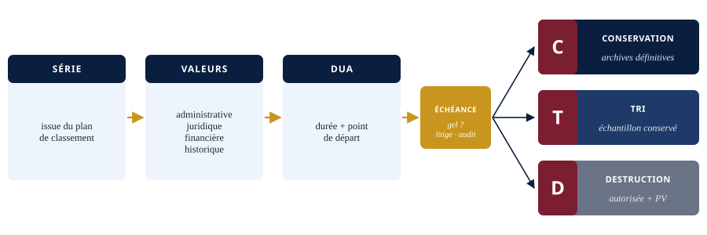

::: situation
Le nouveau directeur d'une société de transport découvre 900 cartons d'archives dans un entrepôt loué. Le loyer coûte cher, l'assureur s'inquiète du risque d'incendie. Sa première réaction : « On jette tout ce qui a plus de cinq ans. » Son comptable l'arrête : certains contrats de location de camions courent encore, un contentieux avec un ancien salarié est en cours, et personne ne sait quelles règles fiscales s'appliquent.

Entre l'accumulation et la destruction hâtive, ce chapitre propose une démarche **raisonnée, documentée et juridiquement prudente**.
:::

::: objectifs
- Identifier les différentes valeurs d'un document.
- Construire et utiliser un tableau de gestion des archives.
- Organiser un versement avec un bordereau.
- Conduire une élimination autorisée, sécurisée et traçable, et savoir la suspendre.
:::

::: attention
**Avertissement juridique.** Les durées de conservation dépendent du **droit applicable dans chaque pays**, et parfois du secteur d'activité, du statut de l'organisation et des contrats signés (conventions de financement, marchés). Ce livre n'énonce **aucune durée légale universelle**. Les exemples chiffrés sont soit attribués à un texte précis d'un pays précis, soit présentés comme des **valeurs fictives** destinées à l'apprentissage. Avant d'appliquer une durée, faites-la valider par un juriste, un expert-comptable ou l'administration des archives compétente.
:::

## Pourquoi fixer des durées de conservation ?

Une durée de conservation répond à deux exigences contraires : garder assez longtemps pour **prouver** et **rendre compte**, mais pas plus longtemps que nécessaire pour **limiter les coûts** et **respecter la protection des données personnelles**, qui impose souvent de ne pas conserver indéfiniment des informations sur les personnes.

Fixer des durées permet aussi de **libérer de l'espace** de façon sereine : on détruit ce qui peut l'être, au bon moment, avec une trace.

## Les valeurs d'un document

Pour fixer une durée, on évalue les **valeurs** du document. Un même document peut en cumuler plusieurs, et la durée retenue est celle de la valeur la plus longue.

| Valeur | Question posée | Exemple | Source de la règle |
|---|---|---|---|
| **Administrative** | Le document est-il encore utile au fonctionnement ? | Procédure interne en vigueur, dossier de projet en cours | Besoins de l'organisation |
| **Juridique** | Prouve-t-il un droit ou une obligation ? | Contrat, titre de propriété, statuts | Lois, délais de prescription, contrats |
| **Financière et comptable** | Justifie-t-il une opération comptable ou fiscale ? | Facture, relevé bancaire, livre comptable | Droit comptable et fiscal national |
| **Historique** | Témoigne-t-il durablement de l'identité et de l'action de l'organisation ? | PV d'AG, rapport annuel, photographies d'événements fondateurs | Évaluation archivistique |

: Les quatre valeurs principales

### Valeur administrative

Elle correspond à l'usage du document pour le travail courant. Elle est généralement la plus courte et se fixe en interne, avec les services.

### Valeur juridique

Elle dépend notamment des **délais de prescription** : la période pendant laquelle une action en justice peut être engagée. Tant qu'une action reste possible, la preuve doit être conservée.

### Valeur financière et comptable

Elle est fixée par le droit comptable et fiscal. **Exemples contextualisés :** en **France**, l'article L123-22 du Code de commerce prévoit que les documents comptables et les pièces justificatives sont conservés pendant **dix ans** ; en matière fiscale, l'article L102 B du Livre des procédures fiscales prévoit un délai général de **six ans** pour les documents sur lesquels l'administration peut exercer son droit de contrôle. Dans les **États membres de l'OHADA**, il convient de se référer à l'Acte uniforme relatif au droit comptable et à l'information financière de 2017 ainsi qu'aux codes fiscaux et sociaux nationaux. Ailleurs, consultez les textes de votre juridiction.

### Valeur historique

Elle ne se déduit pas d'un texte de loi, mais d'une **évaluation** : ce document éclairera-t-il, dans vingt ou cinquante ans, l'histoire et l'action de l'organisation ? Pour une ASBL, les documents de gouvernance, les rapports d'activité et les traces de ses programmes emblématiques en font presque toujours partie.

## L'évaluation archivistique

L'**évaluation** est l'analyse qui permet de déterminer, pour chaque série de documents, sa durée de conservation et son sort final. Elle se mène **par série** (un type de documents produit de façon répétitive), jamais pièce par pièce.

**Démarche :**

1. Partir du **plan de classement** pour lister les séries.
2. Pour chaque série, identifier l'**exemplaire principal** et le service responsable.
3. Analyser les **valeurs** et rechercher les **textes applicables**.
4. Recueillir l'avis des **services**, du **juriste** ou de l'**expert-comptable**.
5. Fixer la **DUA**, le **point de départ** de la durée et le **sort final**.
6. Faire **valider** par la direction.

::: definition
**Point de départ.** Événement à partir duquel la durée est calculée : clôture de l'exercice comptable, fin du contrat, départ du salarié, clôture du projet. Une durée sans point de départ est inapplicable.
:::

## Le tableau de gestion des archives

Le **tableau de gestion** (ou référentiel de conservation) est l'outil qui rassemble, pour chaque série, la durée de conservation et le sort final. Il est l'aboutissement de l'évaluation et l'outil quotidien de l'archiviste.

{width=100%}

### La durée d'utilité administrative (DUA)

La **DUA** est la durée pendant laquelle le document doit être conservé par l'organisation pour des raisons administratives, juridiques ou financières. Elle couvre la phase des archives courantes et intermédiaires.

### Durée de conservation et sort final

À l'issue de la DUA, le tableau prévoit le **sort final**, noté par une lettre :

- **C (conservation)** : le document est conservé définitivement ;
- **D (destruction)** : le document est éliminé selon la procédure autorisée ;
- **T (tri)** : une partie est conservée (échantillon, documents significatifs), le reste est éliminé, selon une règle écrite.

::: horizon
**Extrait du tableau de gestion d'Horizon.** *Les durées ci-dessous sont des valeurs fictives destinées à l'apprentissage. Horizon les a fait vérifier par son expert-comptable et son avocat au regard de la législation de son pays et de ses conventions de financement.*

| Rubrique | Série | Exemplaire principal | Point de départ | DUA | Sort final | Observations |
|---|---|---|---|---|---|---|
| 01.02 | PV et dossiers d'AG | DIR | Date de l'AG | Illimitée | C | Archives définitives |
| 02.03 | Factures fournisseurs | FIN | Clôture de l'exercice | 10 ans | D | Prolonger si un bailleur l'exige |
| 02.05 | Relevés bancaires | FIN | Clôture de l'exercice | 10 ans | D | |
| 03.02 | Dossiers individuels | RHU | Départ du salarié | 5 ans* | T | *À fixer selon le droit social ; conserver les éléments utiles aux droits à pension |
| 04.02 | Dossiers de projets | PRG | Clôture du projet | 10 ans | T | Conserver rapports finaux et photos significatives |
| 05.01 | Conventions de financement | DIR | Fin de la convention | Selon la convention, au moins la durée prévue d'audit | C | Souvent exigé par le bailleur |
| 07.01 | Rapports annuels | COM | Publication | Illimitée | C | Un exemplaire de chaque édition |
:::

Le modèle vierge du tableau de gestion figure en **annexe E**.

## Le versement

Le **versement** est le transfert de documents d'un service vers le service d'archives (ou le local d'archives intermédiaires). Il intervient lorsque les documents ne sont plus d'usage courant, par exemple une fois par an après la clôture des comptes.

**Étapes du versement :**

1. Le service **trie** et retire les doubles et documents sans valeur.
2. Il **conditionne** les dossiers dans des boîtes normalisées.
3. Il rédige le **bordereau de versement**.
4. L'archiviste **contrôle** la conformité entre le bordereau et le contenu des boîtes.
5. Il **cote**, **localise** et **signe** le bordereau ; un exemplaire revient au service.

### Le bordereau de versement

C'est le document qui décrit le contenu du versement et qui **acte le transfert de responsabilité**. Il comporte au minimum : le service versant, la date, le numéro du versement, et pour chaque boîte la cote, l'intitulé des dossiers, les dates extrêmes, la DUA, le sort final et la date d'échéance. Il est signé par le chef du service versant et par l'archiviste. Un modèle complet figure en **annexe F**.

## L'élimination autorisée

L'**élimination** est la destruction de documents dont la DUA est échue et dont le sort final est D (ou la part éliminable d'un tri T). Ce n'est jamais un geste individuel : c'est une **procédure**.

1. L'archiviste extrait du registre la **liste des dossiers éliminables** (échéance dépassée).
2. Il vérifie qu'aucune **suspension** ne s'applique (litige, audit, enquête).
3. La liste est **soumise pour accord** au service producteur et à la direction. Pour les **archives publiques**, de nombreux pays imposent en outre l'autorisation préalable de l'administration des archives : vérifiez votre législation.
4. La destruction est réalisée de manière **sécurisée**.
5. Un **procès-verbal de destruction** est établi et conservé.
6. Le registre de suivi est mis à jour (statut « éliminé »).

### Le procès-verbal de destruction

Il prouve que la destruction a été **autorisée et réalisée** conformément aux règles. Il mentionne : la liste des documents détruits (cotes, intitulés, dates extrêmes, volume), la référence au tableau de gestion, les autorisations obtenues, la date, le mode et le lieu de destruction, le prestataire éventuel et son certificat, les signatures. Ce PV est lui-même conservé **durablement**. Modèle en **annexe G**.

## La destruction sécurisée

Jeter des dossiers du personnel dans une benne publique expose l'organisation à une violation de données. La destruction doit être adaptée à la sensibilité des documents.

| Support | Méthode adaptée | Précaution |
|---|---|---|
| Papier non sensible | Recyclage via filière contrôlée | Vérifier qu'aucun document confidentiel ne s'y trouve |
| Papier confidentiel | Broyage à coupe croisée ou destruction par un prestataire certifié | Exiger un certificat de destruction, assister ou faire assister à l'opération |
| Supports numériques | Effacement sécurisé ou destruction physique du support | S'appuyer sur un référentiel reconnu, par exemple NIST SP 800-88 Rev. 2 (2025) |
| Fichiers dans une GED ou un cloud | Suppression tracée, y compris dans les sauvegardes selon leur cycle | Documenter la suppression dans le journal |

: Modes de destruction

## Suspendre une destruction : litige, audit, enquête

Une règle prime sur toutes les durées : **on ne détruit jamais un document susceptible d'être utile à un litige en cours ou prévisible, à un audit ou à une enquête**, même si sa DUA est échue. On parle de **gel** ou de **suspension de destruction** (*legal hold*).

**Mise en œuvre :**

- la direction ou le juriste **notifie** par écrit la suspension à l'archiviste, en précisant les séries et la période concernées ;
- l'archiviste **marque** les dossiers concernés dans le registre (statut « gelé ») ;
- les éliminations correspondantes sont **bloquées** jusqu'à la levée écrite de la suspension.

::: attention
Détruire des documents après avoir été informé d'un litige ou d'un contrôle peut être assimilé à une destruction de preuves, avec des conséquences juridiques graves. En cas de doute, on suspend.
:::

## Cas pratique : détruire sans savoir

::: cas
**Contexte.** La société de transport de notre situation de départ veut libérer son entrepôt. Le directeur vous confie la mission. On y trouve notamment : des factures et pièces comptables de 2008 à 2024 ; des contrats de location de camions, dont certains en cours ; les dossiers du personnel, dont celui d'un ancien salarié qui a saisi la justice ; des procès-verbaux de conseils d'administration depuis la création ; des catalogues de pièces détachées.

**Questions.**

1. Quelles informations devez-vous réunir avant toute destruction ?
2. Quels documents doivent faire l'objet d'une suspension ?
3. Proposez une démarche en étapes jusqu'à la destruction effective.
:::

::: corrige
1. **Informations préalables :** le droit comptable, fiscal et social applicable dans le pays ; les délais de prescription ; les contrats en cours et leurs clauses ; la liste des litiges, contrôles et audits en cours ou annoncés ; l'avis de l'expert-comptable et de l'avocat.
2. **Suspension :** le dossier de l'ancien salarié et tout document lié au contentieux (paie, plannings, échanges), ainsi que les pièces d'un éventuel contrôle fiscal annoncé.
3. **Démarche :** (a) inventaire sommaire de l'entrepôt par série et par années ; (b) élaboration d'un tableau de gestion validé par la direction et les conseils ; (c) élimination immédiate et documentée des documents sans valeur (catalogues, doublons) ; (d) conservation des PV de conseils (archives définitives) ; (e) liste des éliminables échus soumise à validation ; (f) destruction sécurisée par un prestataire avec certificat ; (g) procès-verbal de destruction ; (h) transfert des archives restantes, organisées et cotées, dans un local adapté.
:::

## Erreurs fréquentes à éviter

::: attention
- **Appliquer une durée trouvée sur Internet** sans vérifier qu'elle concerne votre pays et votre situation.
- **Oublier le point de départ.** « Dix ans » ne veut rien dire sans savoir à partir de quand.
- **Détruire sans procès-verbal.** L'absence de trace rend la destruction suspecte.
- **Ignorer les exigences contractuelles.** Un bailleur peut imposer une durée plus longue que la loi.
- **Négliger les copies et sauvegardes numériques.** Un document détruit en papier mais conservé dans dix boîtes mail n'est pas éliminé.
:::

## À retenir

::: retenir
- Un document peut avoir une valeur **administrative**, **juridique**, **financière** et **historique** ; la plus longue détermine la durée.
- Le **tableau de gestion** fixe, par série, la **DUA**, le **point de départ** et le **sort final** (C, D ou T).
- Le **bordereau de versement** acte le transfert de responsabilité.
- L'élimination est une **procédure** : liste, vérification, autorisation, destruction sécurisée, procès-verbal.
- Litige, audit ou enquête : la **suspension** prime sur toute durée échue.
- Aucune durée n'est universelle : **vérifiez toujours la législation applicable**.
:::

## QCM

::: qcm
**1.** Quand plusieurs valeurs s'appliquent à un document, on retient :\
a) la durée la plus courte ;\
b) la durée la plus longue ;\
c) la moyenne des durées.

**2.** Le sort final « T » signifie :\
a) transfert ;\
b) tri : une partie conservée, une partie éliminée ;\
c) temporaire.

**3.** Le bordereau de versement :\
a) autorise la destruction ;\
b) décrit les documents transférés et acte le transfert de responsabilité ;\
c) remplace le plan de classement.

**4.** Un litige est annoncé concernant un ancien salarié dont le dossier est éliminable. Que faites-vous ?\
a) Vous le détruisez avant l'arrivée de l'avocat adverse.\
b) Vous suspendez la destruction du dossier et des documents liés.\
c) Vous le remettez au salarié.

**5.** Quel document prouve qu'une élimination a été régulière ?\
a) Le procès-verbal de destruction.\
b) La fiche de prêt.\
c) Le registre d'arrivée.

**6.** Pour connaître la durée de conservation des factures, vous :\
a) retenez dix ans partout dans le monde ;\
b) vérifiez le droit comptable et fiscal de votre pays, et vos engagements contractuels ;\
c) demandez à un collègue.
:::

::: corrige
**Corrigé expliqué**

**1. b.** Le document doit rester disponible tant qu'au moins une de ses valeurs l'exige.\
**2. b.** Le tri suit une règle écrite (échantillonnage, sélection des documents significatifs).\
**3. b.** Il est signé par le service versant et par l'archiviste.\
**4. b.** La suspension prime sur la DUA échue ; détruire exposerait l'organisation à de graves sanctions.\
**5. a.** Il mentionne les documents, les autorisations, le mode et la date de destruction.\
**6. b.** Les durées varient selon les pays ; les conventions peuvent imposer des durées plus longues.
:::
