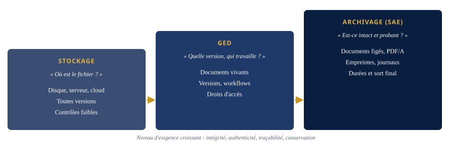
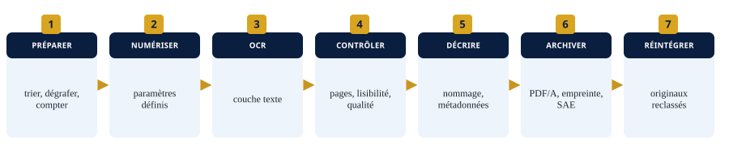

::: situation
Dans un bureau d'études, le serveur partagé compte 640 000 fichiers. On y trouve « Rapport final.docx », « Rapport final V2.docx », « Rapport final DEF.docx » et « Rapport final DEF ok Paul.docx ». Trois chefs de projet ont quitté l'entreprise ; leurs dossiers portent leur prénom. Le jour où un client demande la version remise et signée d'une étude de 2019, personne n'est capable de dire laquelle fait foi.

Le numérique n'a pas supprimé le désordre : il l'a rendu **invisible**, et donc plus dangereux.
:::

::: objectifs
- Distinguer stockage, gestion électronique des documents et archivage électronique.
- Choisir des formats adaptés à la conservation, dont le PDF/A.
- Conduire une numérisation de qualité, avec OCR et contrôle.
- Garantir l'intégrité et l'authenticité des documents numériques.
- Organiser une arborescence, une convention de nommage, des sauvegardes et des migrations.
:::

## Qu'est-ce que l'archivage numérique ?

L'**archivage numérique** (ou électronique) est l'ensemble des moyens organisationnels et techniques qui permettent de conserver des documents numériques de façon à garantir leur **intégrité**, leur **authenticité**, leur **lisibilité** et leur **accessibilité** pendant toute la durée requise. Il s'appuie sur les mêmes principes que l'archivage papier : plan de classement, tableau de gestion, traçabilité. Mais il ajoute une difficulté : le document numérique dépend d'un **format**, d'un **logiciel** et d'un **support** qui vieillissent vite.

## Stockage, GED et archivage électronique : trois réalités différentes

| | Stockage | GED | Archivage électronique (SAE) |
|---|---|---|---|
| **Finalité** | Enregistrer des fichiers | Produire, partager et faire vivre les documents | Conserver des documents figés, probants, sur la durée |
| **Documents** | Tous fichiers, toutes versions | Documents en cours, modifiables, versionnés | Documents validés, non modifiables |
| **Exemples** | Disque dur, serveur partagé, cloud personnel | Outils collaboratifs, logiciels de GED | Système d'archivage électronique dédié, coffre-fort numérique |
| **Contrôles** | Faibles | Droits, versions, workflows | Intégrité, traçabilité complète, durées et sort final |
| **Question clé** | « Où est le fichier ? » | « Qui travaille sur quelle version ? » | « Puis-je prouver que ce document est intact et authentique ? » |

: Trois niveaux à ne pas confondre

{width=100%}

::: definition
**GED (gestion électronique des documents).** Ensemble de logiciels et de procédures pour capturer, indexer, partager, faire circuler et retrouver des documents numériques au quotidien.

**SAE (système d'archivage électronique).** Système conçu pour conserver des documents numériques figés en garantissant leur intégrité, leur traçabilité et l'application des règles de conservation. Les exigences fonctionnelles applicables aux logiciels de gestion des documents d'activité sont décrites notamment par ISO 16175-1:2020.
:::

Le modèle de référence international pour les archives numériques est l'**OAIS** (*Open Archival Information System*), normalisé par ISO 14721, dont l'édition en vigueur date de 2025. Il décrit les fonctions d'un système d'archivage pérenne : entrée, stockage, gestion des données, accès, administration et planification de la préservation.

## Documents natifs numériques et documents numérisés

Un document **natif numérique** est créé directement sous forme électronique : courriel, tableur, facture électronique, document signé électroniquement. Un document **numérisé** est la reproduction d'un original papier.

Cette différence a des conséquences juridiques. Dans de nombreux pays, une copie numérique peut avoir valeur probante si elle est **fidèle et durable**, selon des conditions fixées par la loi. Mais ces conditions varient : **ne détruisez jamais un original papier après numérisation** sans avoir vérifié la législation applicable et, le cas échéant, mis en place un processus de numérisation conforme.

## Les formats documentaires

Un **format** est la façon dont l'information est codée dans un fichier. Pour la conservation, on privilégie des formats **ouverts** (spécifications publiques), **normalisés**, **largement utilisés** et **sans dépendance** à un logiciel unique. La Bibliothèque du Congrès des États-Unis publie chaque année un *Recommended Formats Statement* qui classe les formats préférés et acceptables par type de contenu ; l'édition 2025-2026 est une référence utile.

| Type de contenu | Formats recommandés pour la conservation | Formats à éviter pour l'archivage |
|---|---|---|
| Texte mis en page | PDF/A | Formats propriétaires anciens, fichiers protégés par mot de passe |
| Texte éditable | ODT, DOCX (Office Open XML), TXT | Formats de logiciels disparus |
| Tableaux | ODS, XLSX, CSV pour les données | Fichiers avec macros non documentées |
| Images | TIFF (non compressé ou sans perte), PNG, JPEG pour la diffusion | Formats propriétaires d'appareils |
| Courriels | EML, MBOX, ou export PDF/A du message et des pièces jointes | Archives locales propriétaires isolées |

: Choisir un format adapté

### PDF et PDF/A

Le **PDF** est devenu le format d'échange universel. Le **PDF/A** en est une version **contrainte**, normalisée par la série **ISO 19005**, conçue pour la conservation à long terme : polices **incorporées**, pas de contenu externe, pas de chiffrement, pas de contenu dynamique, métadonnées intégrées. Plusieurs parties coexistent : PDF/A-1 (2005), PDF/A-2 (2011), PDF/A-3 (2012, qui autorise l'incorporation de fichiers de tout type) et PDF/A-4 (2020, fondé sur PDF 2.0).

::: exemple
Pour un rapport annuel validé, l'ASBL produit une version **PDF/A-2b** depuis son traitement de texte (option d'export « conforme PDF/A »), puis la vérifie avec un validateur gratuit. Le fichier source DOCX est conservé à côté, pour d'éventuelles réutilisations.
:::

### Les formats images

Le **TIFF** sans compression avec perte est souvent utilisé comme format de **conservation** (« fichier maître ») pour les numérisations de documents patrimoniaux. Le **JPEG** compresse avec perte : il convient pour la **diffusion** mais pas comme fichier maître de documents précieux. Le **PNG** compresse sans perte et convient aux schémas et captures d'écran.

## La numérisation

**Numériser**, c'est produire une image numérique d'un document physique. C'est un **projet**, pas un geste de bureau : il faut définir les objectifs (faciliter l'accès, sécuriser des documents fragiles, dématérialiser un processus), les documents concernés, les paramètres, le contrôle et la conservation des fichiers.

{width=100%}

### Les paramètres de numérisation

| Paramètre | Définition | Repère pratique |
|---|---|---|
| **Résolution** | Nombre de points par pouce (ppi) | 300 ppi est un minimum courant pour les documents de bureau ; davantage pour les petits caractères et les documents patrimoniaux |
| **Mode couleur** | Noir et blanc, niveaux de gris, couleur | Couleur ou gris dès que des tampons, signatures ou annotations colorées portent du sens |
| **Format de sortie** | Fichier produit | PDF/A pour les documents de bureau ; TIFF maître pour les documents patrimoniaux |
| **Compression** | Réduction du poids du fichier | Sans perte pour les fichiers maîtres |
| **Nommage** | Nom du fichier produit | Selon la convention de l'organisation, avec la cote |

: Paramètres de numérisation

Pour les documents à forte valeur patrimoniale, les **lignes directrices techniques de la FADGI** (*Federal Agencies Digital Guidelines Initiative*, troisième édition, 2023) définissent des niveaux de qualité exigeants et des méthodes de contrôle de l'image.

### La reconnaissance optique de caractères (OCR)

L'**OCR** (*optical character recognition*) transforme l'image d'un texte en texte exploitable : on peut alors chercher un mot dans un document numérisé. Le résultat dépend de la qualité de l'image, de la typographie et de la langue. Les manuscrits, les tampons et les tableaux complexes restent difficiles. Le PDF dit « avec couche texte » superpose le texte reconnu à l'image : on voit l'original, on cherche dans le texte.

::: attention
L'OCR **n'est jamais parfait**. Un montant mal reconnu ou un nom déformé peut fausser une recherche ou une extraction automatique. Pour les données critiques (montants, dates, identifiants), une vérification humaine reste nécessaire.
:::

### Le contrôle qualité

Toute numérisation se contrôle, au moins par **échantillonnage** : nombre de pages conforme à l'original (aucune page oubliée, aucune page en double), lisibilité de chaque page, orientation, absence de coupure des bords, qualité de l'OCR, conformité du nom et des métadonnées, validité du format PDF/A. Les anomalies sont consignées dans une fiche de contrôle et corrigées.

## Les métadonnées

Les **métadonnées** sont des « données sur les données » : elles décrivent le document, son contexte, sa gestion. Sans elles, un fichier est un objet isolé dont on ignore l'origine. Les principes des métadonnées pour les documents d'activité sont posés par la norme **ISO 23081-1:2017**.

On distingue :

- les métadonnées **descriptives** : titre, auteur, date, mots-clés, cote ;
- les métadonnées **de gestion** : niveau de confidentialité, DUA, sort final, droits d'accès ;
- les métadonnées **techniques** : format, taille, logiciel, empreinte numérique ;
- les métadonnées **de traçabilité** : historique des actions (création, validation, consultation, migration).

::: horizon
Pour chaque document versé dans son espace d'archivage, Horizon renseigne dix métadonnées minimales : cote, titre, rubrique, date, producteur, mots-clés, confidentialité, DUA, sort final, empreinte SHA-256. Les six premières sont reprises du registre Excel ; l'empreinte est calculée automatiquement.
:::

## Intégrité et authenticité

L'**intégrité** est la garantie que le document n'a pas été modifié depuis son archivage. L'**authenticité** est la garantie qu'il est bien ce qu'il prétend être, produit par qui il prétend avoir été produit, au moment indiqué.

Pour les assurer :

- **figer** le document dans un format non modifiable (PDF/A) au moment de l'archivage ;
- calculer une **empreinte numérique** (*hash*), par exemple avec l'algorithme **SHA-256** : une suite de caractères unique pour un contenu donné. La moindre modification du fichier change l'empreinte. Recalculer et comparer périodiquement les empreintes permet de détecter toute altération ;
- **tracer** les actions dans un journal ;
- **restreindre** les droits de modification et de suppression ;
- conserver les **signatures électroniques** et leurs éléments de vérification.

## Les sauvegardes

Une sauvegarde n'est pas un archivage, mais il n'y a pas d'archivage sans sauvegarde. La pratique largement recommandée est la règle **3-2-1** : au moins **trois** copies des données, sur **deux** supports différents, dont **une** hors site (ou hors ligne). Les ransomwares ayant pris l'habitude de chiffrer aussi les sauvegardes accessibles, une copie **déconnectée** ou **immuable** est devenue indispensable.

Une sauvegarde non testée est une sauvegarde incertaine : programmez des **tests de restauration** réguliers.

## La migration des formats

Les formats et les logiciels vieillissent. La **migration** consiste à convertir les documents d'un format ou d'un système vers un autre, en préservant leur contenu, leur structure et leur valeur probante. Elle se planifie, se teste et se documente : la norme **ISO 13008:2022** décrit le processus de conversion et de migration des documents numériques. On conserve la trace de chaque migration dans les métadonnées et, lorsque c'est pertinent, le fichier d'origine.

## Organiser les dossiers numériques

L'arborescence des dossiers partagés doit **reprendre le plan de classement**. On évite les dossiers au nom des personnes, les dossiers « Divers » et les profondeurs excessives.

```
HORIZON_ARCHIVES/
├── 01_GOUVERNANCE/
│   ├── 01.02_Assemblee_generale/
│   │   └── 2025/
├── 02_FINANCES/
│   ├── 02.03_Factures_fournisseurs/
│   │   ├── 2025/
│   │   └── 2026/
├── 04_PROGRAMMES/
│   └── 04.02_Projets/
│       └── PRJ-2025-03_Cap_Emploi/
│           ├── 01_Conception/
│           ├── 02_Execution/
│           ├── 03_Suivi_evaluation/
│           └── 04_Rapports/
└── 05_PARTENARIATS/
    └── 05.01_Conventions/
```

## La convention de nommage

Une **convention de nommage** fixe la façon de nommer les fichiers. Elle rend les noms lisibles, triables et compréhensibles hors de leur dossier.

**Règles recommandées :**

1. Commencer par la **date au format AAAAMMJJ** : les fichiers se trient chronologiquement.
2. Ajouter la **rubrique** ou la cote, puis l'**objet** en quelques mots.
3. Indiquer la **version** (v01, v02) pour les documents de travail, et **VF** pour la version finale validée.
4. Proscrire les **espaces**, les **accents**, les caractères spéciaux (/ \\ : * ? " < > | # %) ; utiliser le tiret bas ou le tiret.
5. Limiter la longueur (une soixantaine de caractères est un bon repère).

| Mauvais nom | Bon nom |
|---|---|
| Rapport final DEF ok Paul.docx | 20260115_04.02_CapEmploi_RapportFinal_VF.pdf |
| scan0034.pdf | 20260303_02.03_Delta_Facture7781.pdf |
| PV AG.doc | 20250628_01.02_AG_ProcesVerbal_VF.pdf |

: Exemples de nommage

## Cas pratique : réorganiser un système numérique désordonné

::: cas
**Contexte.** Horizon dispose de quinze ordinateurs, d'un disque partagé et de trois comptes de stockage en ligne personnels. On y trouve des milliers de fichiers en double, des dossiers au nom des salariés, des scans sans nom et des versions multiples des rapports aux bailleurs.

**Travail demandé.** Proposez un plan d'action en étapes pour aboutir à un espace numérique organisé et sécurisé, en précisant pour chaque étape les outils et les responsables.
:::

::: corrige
1. **Geler et inventorier** (semaines 1-2) : interdire la suppression de fichiers, lister les emplacements (postes, disque, comptes en ligne), mesurer les volumes. *Responsables : Esther et le prestataire informatique.*
2. **Rapatrier** vers un espace unique de l'organisation, avec des comptes professionnels, et fermer progressivement les comptes personnels. *Jonas.*
3. **Créer l'arborescence** conforme au plan de classement et la **convention de nommage**, validées par la direction. *Esther.*
4. **Dédoublonner** à l'aide d'un outil de détection des doublons par empreinte, puis **trier** les fichiers par rubrique, service par service. *Chaque service, avec Esther.*
5. **Identifier les versions finales** des documents probants, les convertir en **PDF/A** et les verser dans un espace d'archivage en lecture seule, avec métadonnées et empreinte. *Services producteurs et Esther.*
6. **Paramétrer les droits d'accès** par rubrique et par niveau de confidentialité. *Jonas et le prestataire.*
7. **Mettre en place les sauvegardes 3-2-1** et tester une restauration. *Prestataire.*
8. **Former** les équipes et contrôler l'application à trois mois. *Esther.*
:::

## Erreurs fréquentes à éviter

::: attention
- **Confondre sauvegarde et archivage.** La sauvegarde protège contre la perte ; l'archivage garantit la valeur probante et l'application des durées.
- **Détruire les originaux après numérisation** sans vérifier les conditions légales.
- **Numériser sans contrôle qualité.** Une page oubliée est une preuve perdue.
- **Utiliser des comptes personnels** pour stocker des documents de l'organisation.
- **Laisser vieillir les formats** sans plan de migration.
:::

## À retenir

::: retenir
- **Stockage**, **GED** et **archivage électronique** répondent à des besoins différents.
- Le **PDF/A** (ISO 19005) est le format de référence pour figer les documents mis en page.
- Une numérisation de qualité suppose des **paramètres définis**, un **OCR** vérifié et un **contrôle qualité**.
- **Métadonnées**, **empreintes** et **journaux** garantissent intégrité, authenticité et traçabilité.
- L'arborescence reprend le **plan de classement** ; la **convention de nommage** commence par la date AAAAMMJJ.
- Sauvegardes **3-2-1** testées et **migrations** planifiées assurent la pérennité.
:::

## QCM

::: qcm
**1.** Le PDF/A se distingue du PDF ordinaire parce que :\
a) il est plus léger ;\
b) il est contraint pour la conservation : polices incorporées, pas de contenu externe ni de chiffrement ;\
c) il est modifiable par tous.

**2.** Une empreinte SHA-256 permet :\
a) de compresser un fichier ;\
b) de détecter toute modification d'un fichier ;\
c) de reconnaître le texte d'une image.

**3.** Quelle est la différence entre une GED et un SAE ?\
a) Aucune.\
b) La GED fait vivre les documents en cours ; le SAE conserve des documents figés et probants.\
c) Le SAE est réservé aux images.

**4.** Quel nom de fichier respecte une bonne convention ?\
a) Facture Delta mars.pdf\
b) 20260303_02.03_Delta_Facture7781.pdf\
c) scan_final_OK.pdf

**5.** La règle 3-2-1 signifie :\
a) trois copies, deux supports différents, une copie hors site ;\
b) trois mots de passe, deux administrateurs, un serveur ;\
c) trois ans de conservation, deux sauvegardes, une migration.

**6.** Après numérisation d'un contrat original signé :\
a) on peut toujours détruire l'original ;\
b) on vérifie la législation applicable avant toute destruction de l'original ;\
c) on détruit la copie numérique.
:::

::: corrige
**Corrigé expliqué**

**1. b.** Ces contraintes garantissent un rendu identique et autonome dans le temps.\
**2. b.** La moindre modification change l'empreinte, ce qui révèle l'altération.\
**3. b.** Les deux sont complémentaires : on produit dans la GED, on archive dans le SAE.\
**4. b.** Date AAAAMMJJ, rubrique, objet, sans espaces ni accents.\
**5. a.** Une copie déconnectée ou immuable protège aussi contre les rançongiciels.\
**6. b.** La valeur probante d'une copie numérique dépend du droit applicable et du procédé utilisé.
:::
