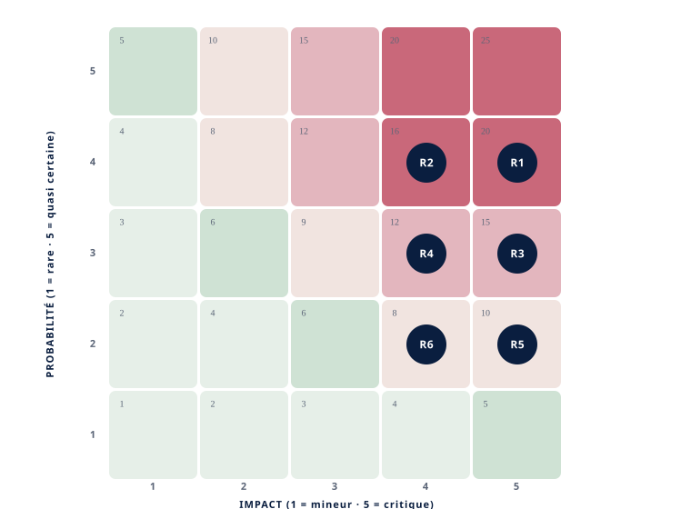

::: situation
Une fondation découvre, en lisant la presse locale, des extraits d'un rapport d'enquête interne sur un ancien partenaire. Le document n'avait jamais été publié. L'enquête révèle qu'une copie avait été imprimée pour une réunion, laissée dans une salle, puis photographiée. Aucune règle de classification n'existait ; le rapport était stocké dans un dossier partagé ouvert à tout le personnel.

La sécurité des archives n'est pas qu'une affaire d'informatique. C'est une question d'**organisation**, de **règles** et de **contrôles**. Pour l'auditeur, c'est un pan à part entière du contrôle interne.
:::

::: objectifs
- Expliquer les cinq exigences de sécurité appliquées aux archives.
- Classifier les documents et organiser les droits d'accès et les prêts.
- Identifier les principaux risques documentaires.
- Construire une cartographie des risques et des contrôles préventifs et correctifs.
:::

## Les cinq exigences de sécurité des archives

La sécurité de l'information s'organise classiquement autour de trois critères : confidentialité, intégrité, disponibilité. Pour les archives, on y ajoute deux exigences propres à la valeur de preuve : authenticité et traçabilité.

{width=100%}

### Confidentialité

L'information n'est accessible qu'aux personnes **autorisées**. *Exemple :* seuls la chargée RH et la direction accèdent aux dossiers individuels du personnel.

### Intégrité

L'information est **complète et non altérée**. *Exemple :* un procès-verbal signé ne peut pas être modifié ; une correction passe par un nouveau document.

### Disponibilité

L'information est **accessible quand on en a besoin**, par les personnes autorisées. *Exemple :* les pièces d'un projet sont retrouvées en moins d'une heure lors d'un audit.

### Authenticité

Le document est bien **ce qu'il prétend être** : produit par l'auteur indiqué, à la date indiquée. *Exemple :* un contrat porte les signatures originales ou une signature électronique vérifiable.

### Traçabilité

Toute action sur le document (création, consultation, modification, déplacement, destruction) laisse une **trace** datée et attribuée. *Exemple :* le journal d'une GED, les fiches de prêt, le procès-verbal de destruction.

::: note
La norme internationale de référence pour les systèmes de management de la sécurité de l'information est **ISO/IEC 27001:2022**. Une PME ou une ASBL n'a pas besoin d'être certifiée pour s'en inspirer.
:::

## Classifier les documents

La **classification** attribue à chaque document ou série un **niveau de sensibilité** qui détermine les règles d'accès, de stockage, de transmission et de destruction. Une classification en quatre niveaux suffit dans la plupart des organisations.

| Niveau | Définition | Exemples | Règles principales |
|---|---|---|---|
| **Public** | Peut être diffusé sans risque | Rapport annuel publié, plaquette | Aucune restriction |
| **Interne** | Réservé au personnel | Procédures, notes de service, planning | Pas de diffusion externe sans accord |
| **Confidentiel** | Réservé à des personnes nommément désignées | Dossiers du personnel, contrats, données des bénéficiaires, comptes avant approbation | Rangement fermé à clé, accès nominatif, transmission chiffrée, broyage |
| **Strictement confidentiel** | Divulgation pouvant causer un préjudice grave | Enquêtes internes, contentieux, données de santé, codes bancaires | Accès très restreint et journalisé, copies interdites ou numérotées |

: Une grille de classification à quatre niveaux

La classification est **indiquée** sur le document (mention en en-tête, métadonnée) et dans le registre de suivi. Elle est attribuée par le **producteur**, selon la grille validée par la direction.

## Gérer les droits d'accès

Deux principes gouvernent l'attribution des accès :

- le **besoin d'en connaître** : on n'accède qu'aux informations nécessaires à sa fonction ;
- le **moindre privilège** : on attribue le niveau de droit minimal (lecture plutôt que modification, modification plutôt que suppression).

**En pratique :**

- établir une **matrice des accès** par rubrique du plan de classement et par fonction (et non par personne) ;
- **revoir** les droits au moins une fois par an et à chaque mouvement de personnel (arrivée, changement de poste, départ) ;
- **désactiver** immédiatement les accès des personnes qui quittent l'organisation, après collecte de leurs documents (chapitre 3) ;
- pour le papier : **armoires fermées à clé**, liste des détenteurs de clés, local d'archives à accès contrôlé.

::: horizon
**Matrice des accès d'Horizon (extrait).** L = lecture, M = modification, 0 = aucun accès.

| Rubrique | DIR | FIN | RHU | PRG | LOG | COM | Référente archives |
|---|---|---|---|---|---|---|---|
| 01 Gouvernance | M | L | 0 | 0 | 0 | L | L |
| 02 Finances | L | M | 0 | L (ses projets) | L (achats) | 0 | L |
| 03.02 Dossiers individuels | L | 0 | M | 0 | 0 | 0 | 0 |
| 04 Programmes | L | L | 0 | M | 0 | L | L |
| 05 Partenariats | M | L | 0 | L | 0 | M | L |

La référente archives n'a pas accès aux dossiers individuels du personnel : leur versement se fait en boîtes scellées, décrites par la RH.
:::

## Gérer les prêts

Le prêt est un moment de vulnérabilité. Les règles vues au chapitre 2 se renforcent pour les documents sensibles :

- **pas de prêt d'original** confidentiel hors du bâtiment ; on communique une copie ou on organise une consultation sur place ;
- **durée de prêt limitée** et relance automatique à l'échéance ;
- **contrôle au retour** : le dossier revient-il complet ? (pagination ou comptage des pièces pour les dossiers sensibles) ;
- **inventaire des prêts en cours** examiné chaque mois.

## Les risques documentaires

Un **risque** est un événement incertain qui, s'il survient, affecte la capacité de l'organisation à atteindre ses objectifs. On le mesure par sa **probabilité** et son **impact**.

| Risque | Exemples de causes | Conséquences possibles |
|---|---|---|
| **Perte** | Absence de classement, prêt non tracé, déménagement, sinistre | Impossibilité de prouver, dépenses inéligibles |
| **Vol** | Local non fermé, départ d'un collaborateur, ordinateur portable non chiffré | Fuite d'informations, atteinte à la vie privée |
| **Falsification** | Documents modifiables, absence de contrôle des versions, signatures scannées réutilisées | Fraude, décisions faussées, sanctions |
| **Divulgation non autorisée** | Droits d'accès trop larges, envoi au mauvais destinataire, impression oubliée | Atteinte à la réputation, sanctions au titre de la protection des données |
| **Cyberattaque** | Hameçonnage, rançongiciel, mots de passe faibles, logiciels non mis à jour | Indisponibilité, chiffrement ou vol de données |

: Les principaux risques documentaires

### Un point sur la protection des données personnelles

Les archives contiennent de nombreuses **données personnelles** (salariés, bénéficiaires, donateurs). Leur traitement est encadré par des lois nationales ou régionales, comme, dans l'Union européenne, le **Règlement (UE) 2016/679** (RGPD). Les principes communs à beaucoup de ces textes sont : finalité déterminée, minimisation, durée de conservation limitée, sécurité, droits des personnes. Identifiez la loi applicable dans votre pays et, le cas échéant, l'autorité de contrôle compétente.

### Les cyberattaques

Le **rançongiciel** (*ransomware*) chiffre les fichiers et exige une rançon. L'**hameçonnage** (*phishing*) dérobe des identifiants par un faux message. Les mesures de base sont connues : mises à jour régulières, authentification à deux facteurs, sensibilisation du personnel, sauvegardes déconnectées testées (chapitre 7), droits d'accès limités.

## Le contrôle interne appliqué aux archives

Le **contrôle interne** est l'ensemble des dispositifs mis en place par une organisation pour maîtriser ses activités et ses risques : fiabilité de l'information, conformité aux lois, protection des actifs. Les archives en sont à la fois **un objet** (elles doivent être protégées) et **un instrument** (elles prouvent que les contrôles ont été réalisés).

### La séparation des responsabilités

Une même personne ne doit pas cumuler des fonctions incompatibles. Pour les archives :

- celui qui **détient** les documents n'est pas celui qui **autorise** leur destruction ;
- celui qui **enregistre** une facture n'est pas celui qui **la paie** ;
- celui qui **modifie** les droits d'accès n'est pas celui qui les **contrôle**.

Dans une petite structure où ces séparations sont difficiles, on compense par des **contrôles de supervision** : revue par la direction, double signature, contrôle a posteriori.

### Les inventaires périodiques

Comme on inventorie les stocks, on inventorie les archives. Un **récolement** consiste à vérifier, à partir du registre, que chaque dossier est bien à sa place. Il peut être complet (tous les cinq ans, par exemple) ou par **sondage** (chaque année, sur un échantillon de rubriques sensibles). Les écarts sont analysés et corrigés.

### La piste d'audit

La **piste d'audit** est la capacité à reconstituer, à partir des documents et des enregistrements, la chaîne complète d'une opération : de la demande d'achat au paiement, du recrutement au départ d'un salarié. Elle suppose que chaque étape ait laissé un document **daté, signé ou validé, et retrouvable**. C'est l'outil privilégié des auditeurs et des bailleurs.

::: exemple
**Piste d'audit d'une dépense de projet :** demande d'achat signée → trois devis → bon de commande approuvé → bon de livraison signé → facture avec visa « service fait » → écriture comptable avec numéro de pièce → ordre de virement à double signature → relevé bancaire. Si un maillon manque, la dépense peut être déclarée inéligible.
:::

## Cartographier les risques documentaires

La **cartographie des risques** recense les risques, les évalue et les hiérarchise. Elle se construit en quatre temps.

1. **Identifier** les risques par rubrique du plan de classement et par étape du cycle de vie.
2. **Évaluer** chaque risque : probabilité (1 à 5) et impact (1 à 5). Le produit donne la **criticité** (1 à 25).
3. **Hiérarchiser** : les risques de criticité élevée sont traités en priorité.
4. **Traiter** : définir des contrôles, un responsable et une échéance, puis réévaluer.

{width=88%}

::: horizon
| Réf. | Risque | P | I | Criticité | Contrôle prévu | Responsable |
|---|---|---|---|---|---|---|
| R1 | Perte des justificatifs de projets | 4 | 5 | 20 | Dossier unique par projet, contrôle trimestriel de complétude | Samuel |
| R2 | Moisissures dans le local | 4 | 4 | 16 | Local déplacé, déshumidificateur, relevés hebdomadaires | Esther |
| R3 | Rançongiciel sur les postes | 3 | 5 | 15 | Sauvegardes 3-2-1, authentification à deux facteurs, formation | Jonas |
| R4 | Divulgation des dossiers RH | 3 | 4 | 12 | Armoire fermée, accès nominatif, journalisation | Grâce |
| R5 | Falsification de factures | 2 | 5 | 10 | Registre d'arrivée, rapprochement commande-livraison-facture | Patrick |
| R6 | Destruction prématurée | 2 | 4 | 8 | Tableau de gestion, double validation, PV | Esther |
:::

## Contrôles préventifs et correctifs

| Type de contrôle | Objectif | Exemples |
|---|---|---|
| **Préventif** | Empêcher l'incident | Classification, droits d'accès, local fermé, double validation des éliminations, formation |
| **Détectif** | Repérer l'incident | Récolements, revue des journaux d'accès, contrôle des empreintes numériques, relevés hygrométriques |
| **Correctif** | Réparer et éviter la répétition | Restauration de sauvegarde, procédure de gestion d'incident, révision des droits, sanction disciplinaire |

: Trois familles de contrôles

Une **checklist de contrôle interne des archives** prête à l'emploi figure en **annexe J**.

## Cas pratique : des documents confidentiels emportés

::: cas
**Contexte.** Un vendredi soir, un chargé de programme d'Horizon, en préavis de départ, emporte chez lui une copie papier des fiches de bénéficiaires d'un projet et télécharge sur une clé USB personnelle les budgets détaillés des trois derniers projets. Un collègue le signale le lundi.

**Questions.**

1. Quelles exigences de sécurité ont été atteintes ?
2. Quelles mesures immédiates prendre ?
3. Quelles défaillances de contrôle interne ont rendu l'incident possible ?
4. Quels contrôles mettre en place pour éviter qu'il se reproduise ?
:::

::: corrige
1. **Confidentialité** (données personnelles des bénéficiaires, informations financières) et **traçabilité** (sortie non enregistrée). L'intégrité et la disponibilité ne sont pas atteintes si les originaux restent en place.
2. **Mesures immédiates :** entretien formel avec le collaborateur, demande de restitution des documents et de la clé, avec procès-verbal ; consignation des faits ; désactivation ou restriction de ses accès ; évaluation de la gravité de l'atteinte aux données personnelles et, si la loi l'exige, notification à l'autorité de contrôle et information des personnes concernées ; avis juridique sur les suites disciplinaires.
3. **Défaillances :** droits d'accès trop larges (accès aux budgets d'autres projets) ; absence de classification des fiches ; ports USB non contrôlés ; pas de procédure de départ (collecte, revue des accès dès le préavis) ; absence de journal des impressions et des téléchargements.
4. **Contrôles à instaurer :** classification et marquage des documents ; matrice des accès fondée sur le besoin d'en connaître ; procédure de départ déclenchée dès la notification du préavis ; contrôle des supports amovibles ; journalisation des accès aux dossiers sensibles ; clause de confidentialité et charte d'utilisation signées ; sensibilisation annuelle.
:::

## Erreurs fréquentes à éviter

::: attention
- **Réduire la sécurité à l'informatique.** Une impression oubliée suffit à provoquer une fuite.
- **Attribuer les droits par personne plutôt que par fonction.** La matrice devient ingérable.
- **Ne jamais revoir les accès.** Les anciens collaborateurs gardent des droits pendant des années.
- **Confier toutes les clés à une seule personne** sans contrôle ni suppléance.
- **Construire une cartographie des risques et la ranger.** Elle doit être revue au moins une fois par an.
:::

## À retenir

::: retenir
- Cinq exigences : **confidentialité, intégrité, disponibilité, authenticité, traçabilité**.
- La **classification** (public, interne, confidentiel, strictement confidentiel) commande les règles de protection.
- Les accès se donnent selon le **besoin d'en connaître** et le **moindre privilège**, et se revoient régulièrement.
- Risques majeurs : **perte, vol, falsification, divulgation, cyberattaque**.
- Le contrôle interne repose sur la **séparation des responsabilités**, les **inventaires**, la **piste d'audit** et une **cartographie des risques** vivante.
:::

## QCM

::: qcm
**1.** Le principe du « besoin d'en connaître » signifie :\
a) chacun accède à tout pour être efficace ;\
b) on n'accède qu'aux informations nécessaires à sa fonction ;\
c) on demande l'accès à son responsable à chaque consultation.

**2.** La criticité d'un risque se calcule généralement en combinant :\
a) son coût et sa durée ;\
b) sa probabilité et son impact ;\
c) son ancienneté et sa fréquence.

**3.** Un récolement est :\
a) la vérification que chaque dossier inscrit au registre est à sa place ;\
b) la destruction des doublons ;\
c) la numérisation d'un fonds.

**4.** Lequel est un contrôle **préventif** ?\
a) La restauration d'une sauvegarde.\
b) La double validation des éliminations.\
c) L'analyse d'un incident passé.

**5.** La piste d'audit permet :\
a) de reconstituer la chaîne complète d'une opération à partir des documents ;\
b) de supprimer les traces d'une opération ;\
c) de classer les documents par ordre alphabétique.

**6.** Dans une petite ASBL où une seule personne gère les archives et propose les éliminations :\
a) aucune mesure n'est nécessaire ;\
b) on compense par une validation de la direction et un contrôle a posteriori ;\
c) on interdit toute élimination.
:::

::: corrige
**Corrigé expliqué**

**1. b.** C'est la base de toute matrice des accès.\
**2. b.** Criticité = probabilité × impact, par exemple sur une échelle de 1 à 5 chacun.\
**3. a.** Le récolement détecte les pertes et les erreurs de rangement.\
**4. b.** Elle empêche une destruction erronée ; les deux autres sont correctifs.\
**5. a.** Chaque étape doit avoir laissé une trace datée et validée.\
**6. b.** Les contrôles de supervision compensent l'impossibilité de séparer les tâches.
:::
