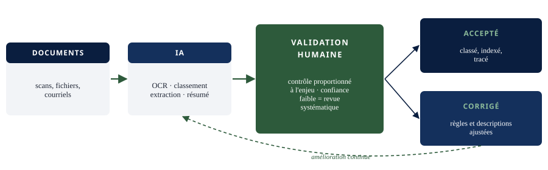

::: situation
Une responsable administrative teste un assistant conversationnel sur 200 factures numérisées. En dix minutes, elle obtient un tableau avec fournisseurs, dates et montants. Impressionnée, elle l'importe dans la comptabilité. Un mois plus tard, le rapprochement bancaire révèle onze écarts : des montants mal lus, deux factures attribuées au mauvais fournisseur et une date… inventée.

L'outil n'était pas mauvais. Il était utilisé **sans méthode** et **sans contrôle**. Ce chapitre vous donne les deux.
:::

::: objectifs
- Comprendre ce que l'intelligence artificielle change au métier d'archiviste.
- Identifier les usages pertinents : OCR, classification, extraction, indexation, recherche, résumé.
- Mesurer les risques : hallucinations, confidentialité, dépendance.
- Rédiger des prompts efficaces et encadrer l'usage de l'IA par une politique.
:::

## La transformation numérique du métier

Le métier d'archiviste a toujours évolué avec les supports : du parchemin au papier, du papier au microfilm, puis au fichier numérique. L'intelligence artificielle (IA) ouvre une nouvelle étape. Elle ne remplace pas les principes (respect des fonds, cycle de vie, évaluation), mais elle **automatise** des tâches répétitives et **aide** à traiter des volumes qu'aucune équipe ne pourrait analyser à la main.

Le rôle de l'archiviste se déplace : moins de saisie, davantage de **conception des règles**, de **paramétrage**, de **contrôle qualité** et de **gouvernance de l'information**.

## L'automatisation documentaire

Avant même l'IA, de nombreux outils automatisent la gestion documentaire :

- les **workflows** de validation (circuit d'une facture dans une GED) ;
- l'**application automatique** des durées de conservation à partir des métadonnées ;
- le **classement automatique** par règles (un courriel contenant un numéro de projet est rangé dans le dossier correspondant) ;
- la **capture** automatisée des pièces jointes et des formulaires.

Ces automatisations à base de **règles explicites** sont prévisibles et vérifiables. L'IA, elle, procède par **apprentissage statistique** : elle est plus souple, mais aussi moins prévisible.

## Reconnaissance automatique des documents et OCR

La **reconnaissance automatique de documents** identifie le type d'un document (facture, contrat, bulletin de paie) à partir de sa mise en page et de son contenu. Elle s'appuie sur l'**OCR**, présenté au chapitre 7, aujourd'hui souvent amélioré par l'IA : meilleure lecture des documents abîmés, des tableaux, voire de certaines écritures manuscrites (on parle alors de **HTR**, *handwritten text recognition*).

## Classification assistée par IA

Un modèle d'IA peut proposer, pour chaque document, une **rubrique du plan de classement**. Il compare le document à des exemples déjà classés ou suit des instructions décrivant les rubriques. La proposition est accompagnée, selon les outils, d'un **score de confiance**.

**Bonne pratique :** accepter automatiquement les propositions à forte confiance **seulement après** une phase de test mesurée, et soumettre les autres à une **validation humaine**.

## Extraction automatique des informations

L'IA peut extraire des **données structurées** d'un document : fournisseur, numéro, date, montant hors taxes, taxes, total, référence de commande pour une facture ; parties, objet, durée, montant pour un contrat. C'est un gain considérable pour l'indexation et la saisie, **à condition de vérifier** les champs critiques.

## Indexation assistée

À partir du contenu, l'IA peut proposer des **mots-clés**, des **noms de personnes et de lieux** et un **résumé**. Pour rester cohérente, l'indexation assistée doit être contrainte par la **liste d'autorité** ou le **thésaurus** de l'organisation (chapitre 4) : on demande à l'outil de choisir dans une liste, pas d'inventer des termes.

## Recherche intelligente

La **recherche sémantique** retrouve des documents par le sens et non par le seul mot exact : une recherche sur « départ d'un salarié » trouve aussi « fin de contrat » et « démission ». Certains outils permettent d'**interroger un fonds en langage naturel** et citent les documents sources. La citation des sources est un critère de choix essentiel : une réponse sans source vérifiable n'a pas de valeur archivistique.

## Résumé de documents

Résumer un rapport de 80 pages, produire la synthèse d'un dossier pour un nouveau collaborateur, rédiger l'analyse d'un dossier pour l'inventaire : l'IA excelle dans ces tâches. Le résumé reste toutefois une **interprétation** ; il ne remplace jamais le document original, qui seul fait foi.

## GED, cloud et IA

De nombreux logiciels de GED et suites bureautiques en ligne intègrent désormais des fonctions d'IA. Avant de les activer, l'organisation doit savoir **où sont hébergées les données**, **si elles servent à entraîner les modèles du fournisseur**, **qui peut y accéder** et **comment elles sont supprimées**. Ces points se vérifient dans le contrat et les conditions du service, pas dans la brochure commerciale.

## L'IA générative et ses risques

L'**IA générative** produit du texte, des images ou du code à partir d'une consigne appelée **prompt**. Les grands modèles de langage sont capables de comprendre une demande en langage courant et de produire une réponse structurée. Trois risques majeurs doivent être maîtrisés.

### Les hallucinations

Une **hallucination** est une réponse fausse présentée avec assurance : une date inventée, une référence juridique inexistante, un montant mal lu. Elle est inhérente au fonctionnement probabiliste de ces modèles. **Parades :** demander à l'outil de citer le passage source, d'indiquer « non trouvé » plutôt que de deviner, et vérifier systématiquement les éléments critiques.

### La confidentialité et la protection des données

Saisir des données personnelles ou confidentielles dans un outil d'IA grand public peut constituer une **divulgation** à un tiers. **Règles :** n'utiliser que des outils **approuvés par l'organisation**, sous contrat ; **anonymiser** ou **pseudonymiser** les données lorsque c'est possible ; ne jamais soumettre de documents classés « strictement confidentiel » à un service externe non autorisé ; respecter la loi de protection des données applicable.

### La dépendance et la perte de compétences

Si plus personne ne sait classer sans l'outil, l'organisation devient vulnérable. Les règles (plan de classement, tableau de gestion) doivent rester **documentées et comprises** par les équipes.

## La validation humaine

Le principe central est simple : **l'IA propose, l'humain dispose**. Plus l'enjeu est élevé (valeur probante, données personnelles, décision d'élimination), plus le contrôle humain doit être fort.

{width=100%}

| Niveau d'enjeu | Exemples | Contrôle humain |
|---|---|---|
| Faible | Proposition de mots-clés, résumé interne | Contrôle par échantillon |
| Moyen | Classement dans le plan, extraction de champs pour l'indexation | Validation des cas à faible confiance, échantillon des autres |
| Élevé | Données comptables, décision de sort final, données personnelles | Validation systématique, document par document |

: Adapter le contrôle humain à l'enjeu

::: definition
**Prompt.** Instruction rédigée en langage naturel pour obtenir un résultat d'un outil d'IA générative. Un bon prompt précise le **rôle**, le **contexte**, la **tâche**, les **données**, le **format de sortie** et les **contraintes**.
:::

## Des prompts réellement utilisables

Les prompts ci-dessous sont des modèles. Remplacez les éléments entre crochets. Ils supposent l'usage d'un outil **autorisé par votre organisation**.

::: prompt
**1. Classer des documents dans le plan de classement**

*Objectif :* proposer une rubrique pour chaque document. *Données nécessaires :* le plan de classement (codes et intitulés) et, pour chaque document, son titre et un extrait. *Résultat attendu :* un tableau. *Précautions :* validation humaine des cas incertains ; pas de données personnelles sensibles.

> Tu es archiviste. Voici le plan de classement de mon organisation : [coller les codes et intitulés]. Pour chacun des documents suivants [liste : n°, titre, extrait de 3 lignes], propose la rubrique la plus adaptée. Réponds sous forme de tableau avec les colonnes : n°, rubrique proposée, justification en une phrase, niveau de confiance (élevé, moyen, faible). N'invente aucune rubrique : si aucune ne convient, écris « à examiner ».
:::

::: prompt
**2. Identifier les informations d'une facture**

*Objectif :* extraire les champs utiles à l'enregistrement. *Données :* le texte OCR de la facture (ou l'image si l'outil l'accepte). *Résultat :* des champs structurés. *Précautions :* vérifier montants et dates contre l'original ; ne jamais importer en comptabilité sans contrôle.

> Extrais de la facture ci-dessous les informations suivantes : nom du fournisseur, numéro de facture, date d'émission, date d'échéance, montant hors taxes, montant des taxes, montant total, devise, référence de commande. Présente le résultat en tableau à deux colonnes (champ, valeur). Pour chaque valeur, cite entre guillemets le passage exact du document dont elle provient. Si une information est absente ou illisible, écris « non trouvé » : ne déduis et n'invente rien.
> [Texte de la facture]
:::

::: prompt
**3. Produire des métadonnées**

*Objectif :* préparer la description d'un document avant son archivage. *Données :* le texte du document, la liste d'autorité des mots-clés. *Résultat :* une fiche de métadonnées. *Précautions :* contrôler la cohérence avec le registre ; choisir les mots-clés dans la liste fournie.

> À partir du document ci-dessous, propose une fiche de métadonnées avec : titre normalisé (moins de 80 caractères), date du document au format AAAA-MM-JJ, auteur ou organisme producteur, type de document, résumé en deux phrases, trois à six mots-clés choisis uniquement dans cette liste [liste d'autorité], niveau de confidentialité suggéré (public, interne, confidentiel, strictement confidentiel) avec sa justification. Signale tout élément incertain.
> [Texte du document]
:::

::: prompt
**4. Proposer un plan de classement**

*Objectif :* obtenir une première trame à discuter avec les services. *Données :* la mission de l'organisation, ses activités principales, ses services. *Résultat :* un projet de plan fonctionnel. *Précautions :* c'est un brouillon ; il doit être testé et validé (chapitre 3).

> Tu es consultant en gestion documentaire. Mon organisation est [type, secteur, taille]. Ses missions sont [missions]. Ses activités principales sont [liste]. Propose un plan de classement fonctionnel (organisé par fonctions et activités, et non par services) de trois niveaux au maximum, avec une codification décimale (01, 01.01…). Pour chaque rubrique de second niveau, donne deux exemples de documents. Termine par trois questions que je devrais poser aux services pour valider ce plan.
:::

::: prompt
**5. Résumer un rapport**

*Objectif :* produire une synthèse fidèle. *Données :* le rapport. *Résultat :* un résumé structuré avec renvois. *Précautions :* le résumé ne remplace pas l'original ; vérifier les chiffres cités.

> Résume le rapport ci-dessous pour [public : direction, conseil d'administration, nouveau collaborateur] en 300 mots maximum, avec les rubriques : objet, principaux constats, chiffres clés, recommandations, points de vigilance. Pour chaque chiffre et chaque recommandation, indique la page ou la section d'origine. N'ajoute aucune information qui ne figure pas dans le rapport.
> [Texte du rapport]
:::

::: prompt
**6. Repérer des anomalies documentaires**

*Objectif :* détecter des incohérences dans un ensemble de pièces. *Données :* un tableau des pièces (date, numéro, fournisseur, montant, référence de commande, référence de paiement). *Résultat :* une liste d'anomalies à vérifier. *Précautions :* une anomalie signalée n'est pas une fraude ; c'est une piste à examiner par un humain.

> Voici un tableau de [nombre] pièces justificatives d'un projet [coller le tableau]. Identifie les anomalies possibles : numéros de facture en double, même montant payé deux fois au même fournisseur, dates incohérentes (facture postérieure au paiement, date hors période du projet), factures sans référence de commande ou de paiement, ruptures de numérotation. Présente un tableau : n° de ligne, type d'anomalie, explication, vérification à effectuer. Ne conclus pas à une fraude.
:::

## Une politique d'utilisation responsable de l'IA

L'usage de l'IA doit être **encadré par écrit**. Des référentiels peuvent guider la démarche : le **cadre de gestion des risques de l'IA** du NIST américain (*AI RMF 1.0*, janvier 2023), la norme **ISO/IEC 42001:2023** relative aux systèmes de management de l'IA, et, pour les organisations concernées par le droit européen, le **Règlement (UE) 2024/1689** sur l'intelligence artificielle. Une politique interne d'une ou deux pages peut couvrir l'essentiel :

| Rubrique | Contenu |
|---|---|
| Outils autorisés | Liste des outils approuvés, sous contrat, et conditions d'usage |
| Données interdites | Données strictement confidentielles, données de santé, données d'identification sans autorisation |
| Usages autorisés | Classement, extraction, résumé, rédaction de brouillons, avec contrôle |
| Usages interdits | Décisions d'élimination, décisions sur les personnes, production de documents probants sans validation |
| Validation humaine | Niveaux de contrôle selon l'enjeu, responsable désigné |
| Traçabilité | Mention de l'usage de l'IA dans les métadonnées ou le registre lorsque pertinent |
| Formation | Sensibilisation des utilisateurs aux limites et aux risques |
| Révision | Revue annuelle de la politique |

: Contenu d'une politique d'usage responsable de l'IA

## Cas pratique : la classification assistée chez Horizon

::: cas
**Contexte.** Horizon doit classer 4 000 fichiers rapatriés des postes de travail (chapitre 7). Jonas propose d'utiliser l'outil d'IA intégré à la suite bureautique sous contrat de l'organisation. Mireille demande un plan de mise en œuvre sécurisé.

**Travail demandé.** Concevez la démarche, de la préparation à la généralisation, en précisant les contrôles.
:::

::: corrige
1. **Cadrer** : vérifier le contrat (hébergement, non-réutilisation des données pour l'entraînement, suppression), exclure du périmètre les dossiers RH et les données de bénéficiaires, faire valider par la direction.
2. **Préparer** : fournir à l'outil le plan de classement d'Horizon avec une description de chaque rubrique et trois exemples de documents par rubrique.
3. **Tester** : soumettre un échantillon de 200 fichiers déjà classés par Esther. Mesurer le **taux de concordance** global et par rubrique. Objectif fixé : au moins 90 % sur les propositions à confiance élevée.
4. **Ajuster** : préciser les descriptions des rubriques les plus confondues (par exemple 04.02 Projets et 05.02 Rapports aux bailleurs), puis retester.
5. **Déployer par lots** de 500 fichiers : acceptation des propositions à confiance élevée, **validation humaine** des autres par les services.
6. **Contrôler** : Esther vérifie un échantillon de 5 % des propositions acceptées ; les erreurs sont analysées.
7. **Tracer et capitaliser** : noter dans le registre les lots traités avec l'IA, documenter la méthode et intégrer les règles dans la politique d'usage.

**Résultat attendu :** un gain de temps important, sans perte de maîtrise : chaque fichier reste rattaché au plan validé, et chaque décision sensible relève d'un humain.
:::

## Erreurs fréquentes à éviter

::: attention
- **Croire l'IA sur parole.** Une réponse fluide n'est pas une réponse vraie.
- **Coller des données confidentielles dans un outil grand public.** C'est une divulgation.
- **Laisser l'IA inventer des mots-clés ou des rubriques.** Contraignez-la avec vos listes.
- **Automatiser une décision d'élimination.** Le sort final relève d'une procédure validée par des humains.
- **Déployer sans test mesuré.** Sans taux de concordance, impossible de savoir si l'outil est fiable.
:::

## À retenir

::: retenir
- L'IA **automatise** l'OCR, la classification, l'extraction, l'indexation, la recherche et le résumé.
- Ses risques majeurs : **hallucinations**, atteintes à la **confidentialité**, **dépendance**.
- **L'IA propose, l'humain dispose** : le contrôle est proportionné à l'enjeu.
- Un bon prompt précise **rôle, contexte, tâche, données, format, contraintes**, et demande de citer les sources.
- Une **politique d'usage responsable** écrite encadre les outils, les données et les validations.
:::

## QCM

::: qcm
**1.** Une hallucination d'IA est :\
a) une panne du logiciel ;\
b) une réponse fausse présentée avec assurance ;\
c) un document illisible.

**2.** Pour limiter les inventions lors d'une extraction de facture, on demande à l'outil :\
a) de deviner les champs manquants ;\
b) de citer le passage source et d'écrire « non trouvé » si l'information manque ;\
c) de répondre le plus vite possible.

**3.** Quelle décision ne doit jamais être automatisée ?\
a) La proposition de mots-clés.\
b) La décision d'élimination de documents.\
c) La reconnaissance du texte d'un scan.

**4.** Avant d'activer l'IA d'un logiciel de GED en ligne, il faut vérifier :\
a) la couleur de l'interface ;\
b) l'hébergement, la réutilisation éventuelle des données et les conditions de suppression ;\
c) le nombre d'utilisateurs dans le monde.

**5.** Pour une indexation assistée cohérente, on :\
a) laisse l'outil proposer librement des mots-clés ;\
b) contraint l'outil à choisir dans la liste d'autorité ;\
c) supprime le thésaurus.

**6.** Avant de généraliser une classification assistée, on :\
a) mesure le taux de concordance sur un échantillon déjà classé ;\
b) l'applique directement à tous les fichiers ;\
c) supprime le plan de classement.
:::

::: corrige
**Corrigé expliqué**

**1. b.** C'est une limite intrinsèque des modèles génératifs.\
**2. b.** La citation du passage source permet une vérification rapide.\
**3. b.** Le sort final engage la responsabilité de l'organisation et suit une procédure d'autorisation.\
**4. b.** Ces conditions déterminent les risques pour la confidentialité.\
**5. b.** Le vocabulaire contrôlé garantit des recherches fiables.\
**6. a.** Le test mesuré permet de fixer le niveau de contrôle humain nécessaire.
:::
