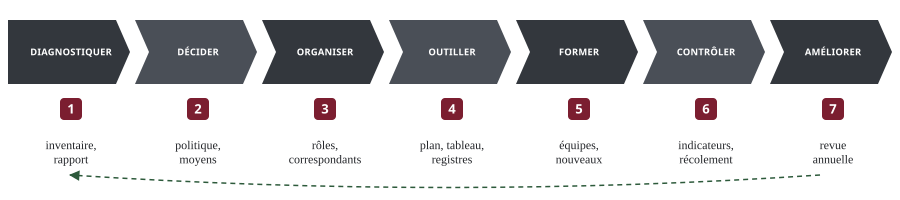
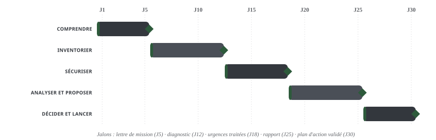

::: situation
Vous venez d'être nommé responsable des archives, ou un client vous confie la mission d'organiser les siennes. Vous avez lu les neuf chapitres précédents. Une question demeure : **par où commencer**, et comment éviter que le projet s'essouffle au bout de trois mois ?

La réponse tient en une démarche : **diagnostiquer, décider, organiser, outiller, former, contrôler, améliorer**.
:::

::: objectifs
- Conduire un diagnostic archivistique et en rédiger le rapport.
- Élaborer une politique d'archivage et organiser le service.
- Mettre en place les procédures, les registres et la formation.
- Piloter le service par des indicateurs, gérer les incidents et améliorer en continu.
:::

{width=100%}

## Le diagnostic initial

Le **diagnostic archivistique** est l'état des lieux de la gestion des documents d'une organisation. Il donne une base factuelle aux décisions et un point de référence pour mesurer les progrès. Il s'appuie sur trois sources : les **entretiens**, l'**observation** des lieux et des systèmes, et l'**analyse des documents** (organigramme, procédures existantes, contrats).

### L'inventaire de l'existant

On recense, local par local et système par système :

- les **volumes** : nombre de boîtes, mètres linéaires (ml) de rayonnages occupés, gigaoctets de fichiers ;
- les **types de documents** et les **périodes** couvertes ;
- les **conditions de conservation** (climat, sécurité, état des documents) ;
- les **outils existants** : registres, listes, logiciels, arborescences.

::: note
Le **mètre linéaire** est l'unité de mesure des archives physiques : la longueur de tablette occupée. Une boîte d'archives standard de 10 cm de dos occupe 0,10 ml.
:::

### L'identification des services producteurs

Pour chaque service : ses missions, les documents qu'il produit et reçoit, ses besoins de consultation, ses difficultés, ses obligations particulières (bailleurs, réglementation). Ces entretiens préparent le plan de classement et le tableau de gestion.

### L'analyse des dysfonctionnements

Les constats sont regroupés par thème (organisation, classement, conservation, numérique, sécurité, conformité) et analysés selon leur **gravité** et leur **cause**. La question utile n'est pas « qu'est-ce qui ne va pas ? », mais « **pourquoi** cela ne va-t-il pas ? » : un dossier perdu est un symptôme ; l'absence de fiche de prêt en est la cause.

### Le rapport de diagnostic

Le rapport, de cinq à quinze pages, est destiné à la direction. Il comprend :

1. le **contexte** et la méthode ;
2. l'**état des lieux** chiffré ;
3. les **constats** et leur analyse de risque ;
4. les **recommandations** hiérarchisées ;
5. un **plan d'action** avec un calendrier, des responsables et un budget indicatif.

Une **fiche de diagnostic archivistique** est proposée en **annexe H**.

## Élaborer une politique d'archivage

La **politique d'archivage** est le document de référence, approuvé par la direction (ou le conseil d'administration pour une ASBL), qui fixe les principes, les responsabilités et les règles de gestion des documents. La norme ISO 15489-1:2016 insiste sur ce point : politiques, responsabilités et formation sont les conditions d'une gestion des documents efficace.

**Contenu type :**

- **objet et champ d'application** : tous les documents, papier et numériques, de tous les services ;
- **principes** : respect des fonds, cycle de vie, valeur probante, protection des données ;
- **rôles et responsabilités** ;
- **référentiels** : plan de classement, tableau de gestion, grille de classification, convention de nommage ;
- **règles** de conservation, de versement, de communication, d'élimination, de numérisation ;
- **sécurité** et usage de l'IA ;
- **contrôle**, indicateurs et **révision**.

Un modèle complet figure en **annexe I**.

## Organiser le service

### La répartition des responsabilités

| Acteur | Responsabilités |
|---|---|
| **Direction** | Approuve la politique, alloue les moyens, valide les éliminations, arbitre |
| **Responsable des archives** | Conçoit les référentiels, conseille, collecte, conserve, communique, contrôle, forme |
| **Chefs de service** | Font appliquer les règles dans leur service, valident les versements, désignent un correspondant |
| **Correspondants archives** | Relais dans chaque service : classement courant, préparation des versements |
| **Tout collaborateur** | Applique les règles, ne détruit rien hors procédure, signale les incidents |
| **Informatique** | Droits d'accès, sauvegardes, sécurité, outils numériques |
| **Auditeurs, contrôle interne** | Évaluent périodiquement le dispositif |

: Qui fait quoi ?

### Les ressources humaines et matérielles

Un service d'archives efficace n'exige pas des moyens démesurés, mais des moyens **réels** :

- **du temps dédié** : pour une organisation de 40 à 60 personnes, une fraction significative d'un poste, au moins pendant la phase de mise en place ;
- **un local** adapté (chapitre 5) et du **matériel** de conditionnement ;
- **un espace numérique** structuré, avec des droits maîtrisés et des sauvegardes ;
- **un budget** pour la formation, les éventuels prestataires (désinfection, destruction sécurisée, numérisation) et les outils.

## Le plan de classement, les procédures et les registres

Le **plan de classement** (chapitre 3) et le **tableau de gestion** (chapitre 6) sont les deux référentiels centraux. Ils sont complétés par des **procédures** courtes, d'une à deux pages chacune, rédigées avec les services :

- réception et enregistrement du courrier ;
- circuit des factures ;
- constitution et versement des dossiers ;
- prêt et consultation ;
- élimination ;
- numérisation ;
- arrivée et départ d'un collaborateur ;
- gestion des incidents.

Les **registres** donnent corps à ces procédures : registre d'arrivée et de départ, registre de suivi documentaire (répertoire), registre des prêts, registre des éliminations (avec les procès-verbaux), registre des incidents. Les modèles figurent en annexes.

## Former le personnel

Un système d'archivage repose sur les gestes de chacun. La formation doit être **courte**, **pratique** et **répétée** :

- une **séance d'accueil** pour tout nouvel arrivant (30 minutes) : principes, plan de classement, nommage, sécurité ;
- des **ateliers par service** (une à deux heures) sur leurs propres documents ;
- une **formation approfondie** pour les correspondants archives ;
- des **rappels** réguliers : fiche mémo d'une page, message mensuel, quiz.

## Contrôle, suivi et indicateurs de performance

On ne pilote que ce que l'on mesure. Quelques indicateurs bien choisis suffisent.

| Indicateur | Mode de calcul | Cible indicative |
|---|---|---|
| Délai moyen de recherche | Temps entre la demande et la remise du document | À fixer selon le point de départ, puis à réduire |
| Taux de documents retrouvés | Demandes satisfaites / demandes reçues | Proche de 100 % |
| Taux de conformité du nommage | Fichiers conformes / échantillon contrôlé | En progression à chaque contrôle |
| Taux de versements réalisés | Services ayant versé / services concernés | 100 % à l'échéance annuelle |
| Prêts en retard | Nombre de prêts dépassant la date de retour | Tendre vers zéro |
| Éliminations réalisées dans les délais | Lots éliminés / lots éligibles | En progression, toujours avec PV |
| Conditions climatiques | Relevés hors plage / relevés totaux | Le plus bas possible |
| Personnel formé | Personnes formées / effectif | 100 % des nouveaux arrivants |
| Incidents documentaires | Nombre et gravité par trimestre | En baisse, chacun analysé |

: Tableau de bord des archives

Les cibles sont fixées par l'organisation à partir de la mesure de départ : un indicateur sert d'abord à **suivre une tendance**.

## Gérer les incidents

Un **incident documentaire** est tout événement qui compromet la confidentialité, l'intégrité, la disponibilité ou la traçabilité des archives : dossier perdu, prêt non restitué, fuite, dégât des eaux, fichier supprimé, cyberattaque.

**Procédure en cinq temps :** (1) **signaler** sans délai au responsable des archives ; (2) **contenir** (sécuriser, restreindre, isoler) ; (3) **évaluer** l'impact, y compris les éventuelles obligations de notification au titre de la protection des données ; (4) **corriger** ; (5) **analyser** les causes et mettre à jour les procédures. Chaque incident est consigné dans le **registre des incidents**.

## L'amélioration continue

Le service d'archives suit un cycle d'amélioration : **planifier** (objectifs annuels), **faire** (mettre en œuvre), **vérifier** (indicateurs, contrôles, audits), **agir** (corriger, ajuster les référentiels). Une **revue annuelle**, présentée à la direction, dresse le bilan, actualise le tableau de gestion et le plan de classement, et fixe les priorités de l'année suivante. Cette logique est celle des normes de systèmes de management, dont la série ISO 30300 appliquée aux documents d'activité.

## Étude de cas intégrée : l'Organisation Horizon, dix-huit mois plus tard

::: horizon
**Rappel du point de départ (chapitre 1) :** aucun plan de classement, factures dispersées, contrats dans des tiroirs, dossiers du personnel incomplets, archives dans un sous-sol humide, fichiers sur quinze ordinateurs, aucun registre, aucune politique, risques de perte et de divulgation.

**Les étapes franchies.**

| Période | Réalisations | Chapitre |
|---|---|---|
| Mois 1 | Diagnostic, rapport à la direction, désignation d'Esther comme référente archives | 10 |
| Mois 2-3 | Plan de classement fonctionnel en 7 fonctions, codification HOR, convention de nommage | 3, 7 |
| Mois 3 | Registre d'arrivée unique, circuit des factures, fiches de prêt | 2 |
| Mois 4 | Déménagement des archives au 1er étage, traitement des boîtes moisies, rayonnages | 5 |
| Mois 4-6 | Collecte et tri : 38 ml de documents traités, 11 ml éliminés avec PV | 3, 6 |
| Mois 5-7 | Cotation, localisation, registre de suivi Excel (2 400 dossiers décrits) | 4 |
| Mois 6 | Tableau de gestion validé par l'expert-comptable et l'avocat | 6 |
| Mois 6-9 | Espace numérique unique, dédoublonnage, PDF/A, sauvegardes 3-2-1 | 7 |
| Mois 8 | Classification, matrice des accès, cartographie des risques | 8 |
| Mois 10 | Classification assistée par IA de 4 000 fichiers, avec validation | 9 |
| Mois 12 | Politique d'archivage adoptée par le conseil d'administration | 10 |
| Mois 18 | Première revue annuelle et audit de bailleur réussi | 10 |

**Le système en place.** Horizon dispose d'une **politique d'archivage** approuvée ; d'un **plan de classement** commun au papier et au numérique ; d'un **tableau de gestion** validé ; d'un **local** sec, fermé et équipé ; d'un **espace numérique** unique avec droits par fonction ; d'un **registre de suivi** de 2 400 dossiers ; de **correspondants archives** dans chaque service ; d'un **tableau de bord** trimestriel.

**Les résultats.** Lors de l'audit du nouveau projet financé par la Fondation Alizé, toutes les pièces demandées ont été remises en deux jours ouvrables, avec une piste d'audit complète. Le temps moyen de recherche d'un dossier est passé de plusieurs heures à quelques minutes. Les dossiers du personnel sont complets et protégés.

**Ce qui reste à faire.** Étendre le dispositif aux deux antennes, améliorer le taux de conformité du nommage (encore 78 %) et préparer le transfert des archives définitives les plus anciennes dans des boîtes de conservation.
:::

## Feuille de route : vos trente premiers jours

Que vous soyez salarié ou consultant, ces trente jours posent les fondations. L'objectif n'est pas de tout régler, mais d'obtenir un **diagnostic partagé**, des **premières mesures visibles** et un **mandat** clair.

{width=100%}

| Semaine | Actions | Livrable |
|---|---|---|
| **Jours 1 à 5 : comprendre** | Rencontrer la direction, obtenir une lettre de mission ; lire statuts, organigramme, procédures ; visiter tous les lieux de stockage ; repérer les urgences (humidité, sécurité) | Lettre de mission, liste des urgences |
| **Jours 6 à 12 : inventorier** | Entretiens avec chaque service ; inventaire des volumes papier et numériques ; photos des locaux ; relevés climatiques | Fiches de diagnostic remplies |
| **Jours 13 à 18 : sécuriser** | Mesures conservatoires : sortir les cartons du sol, isoler les documents moisis, fermer les accès, suspendre toute destruction ; registre d'arrivée unique | Mesures d'urgence réalisées |
| **Jours 19 à 25 : analyser et proposer** | Analyse des dysfonctionnements ; premier projet de plan de classement ; ébauche de politique ; plan d'action à 12 mois chiffré | Rapport de diagnostic |
| **Jours 26 à 30 : décider et lancer** | Présentation à la direction ; validation des priorités, des moyens et des correspondants ; communication à l'ensemble du personnel | Plan d'action validé, note de lancement |

: Les trente premiers jours

## Erreurs fréquentes à éviter

::: attention
- **Commencer par acheter un logiciel.** L'outil vient après les règles, pas avant.
- **Travailler seul.** Sans la direction et les services, aucun système ne tient.
- **Vouloir traiter tout l'arriéré avant de régler le flux.** Organisez d'abord les documents qui arrivent chaque jour, sinon l'arriéré se reconstitue.
- **Rédiger une politique de trente pages.** Courte, claire et appliquée vaut mieux qu'exhaustive et ignorée.
- **Oublier de mesurer.** Sans indicateurs, les progrès sont invisibles et les moyens disparaissent.
:::

## À retenir

::: retenir
- Tout commence par un **diagnostic** : inventaire, services producteurs, dysfonctionnements, rapport.
- La **politique d'archivage**, approuvée par la direction, fixe principes, rôles et référentiels.
- Le service s'appuie sur des **correspondants**, des **procédures courtes**, des **registres** et une **formation** continue.
- Quelques **indicateurs** bien choisis et un **registre des incidents** permettent de piloter.
- L'**amélioration continue** et la **revue annuelle** font vivre le système dans la durée.
:::

## QCM

::: qcm
**1.** Quelle est la première étape de la mise en place d'un service d'archives ?\
a) L'achat d'un logiciel de GED.\
b) Le diagnostic de l'existant.\
c) L'élimination des documents anciens.

**2.** Qui approuve la politique d'archivage ?\
a) Le stagiaire chargé du classement.\
b) La direction, ou le conseil d'administration pour une ASBL.\
c) Le fournisseur du logiciel.

**3.** Le mètre linéaire mesure :\
a) la longueur de tablette occupée par des archives ;\
b) la hauteur du local ;\
c) le poids des boîtes.

**4.** Que faut-il organiser en priorité ?\
a) L'arriéré le plus ancien.\
b) Le flux des documents qui arrivent chaque jour.\
c) Les archives définitives uniquement.

**5.** Un correspondant archives est :\
a) un prestataire externe ;\
b) un relais désigné dans chaque service ;\
c) un auditeur.

**6.** Un incident documentaire doit être :\
a) caché pour ne pas inquiéter la direction ;\
b) signalé, contenu, évalué, corrigé et analysé ;\
c) traité uniquement par l'informatique.
:::

::: corrige
**Corrigé expliqué**

**1. b.** Le diagnostic fonde toutes les décisions et sert de référence pour mesurer les progrès.\
**2. b.** L'approbation au plus haut niveau donne autorité à la politique.\
**3. a.** C'est l'unité de mesure des volumes d'archives physiques.\
**4. b.** Maîtriser le flux évite que le désordre se reconstitue pendant le traitement de l'arriéré.\
**5. b.** Il applique et relaie les règles au plus près des documents.\
**6. b.** Le registre des incidents nourrit l'amélioration continue.
:::
